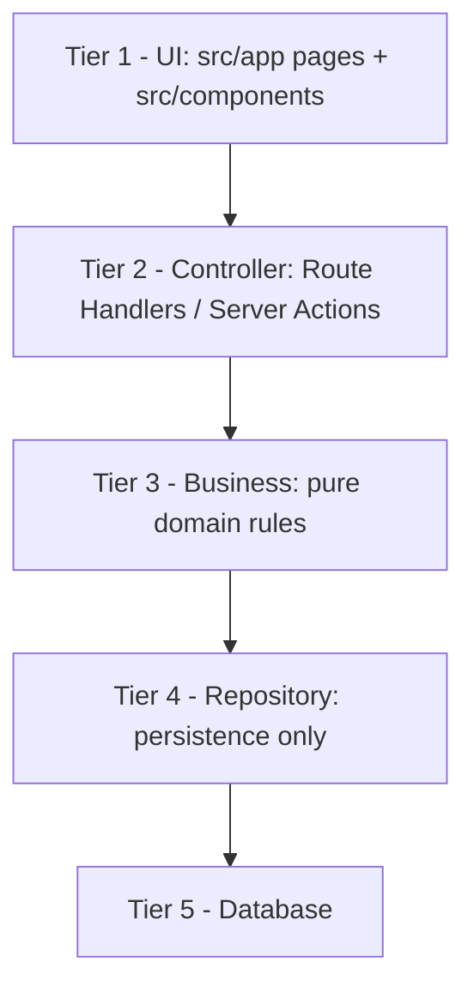

# Kanjo V2.0 — Architecture Blueprint

Branch: `feat/v2-enterprise-architecture`
Stack: Next.js 15.5 App Router · React 19 · TypeScript 5.7 · Zod 3.24 · Headless UI 2.2 · Tailwind 3.4

This document is the single source of truth for **where code belongs**. Read it
before touching any module. `AGENTS.md` holds the mandatory rules; this file
holds the map and the migration status.

---

## 1. The Five Tiers

Requests flow strictly downward. A tier may only import from tiers **below**
it. Never import upward, never skip a tier.

| Tier | Responsibility | Location | May import |
|---|---|---|---|
| 1 — UI | Render, view state, handlers. No domain rules, no I/O. | `src/app/**/page.tsx`, `src/components/**`, `src/components/ui/**` | T2 |
| 2 — Controller | Auth/authorization, input validation (Zod), status codes, shaping responses. No business rules. | `src/app/api/**/route.ts`, `src/lib/auth/api.ts` | T3 |
| 3 — Business | Domain rules, invariants, calculations. Zero DB or UI imports. | `src/lib/<domain>/*.ts` | T4 (types only ideally) |
| 4 — Repository | Only layer that reads/writes the store. Doc mapping and queries. | `src/lib/<domain>/store/**`, `src/lib/<domain>/firestore.ts` | T5 |
| 5 — Database | Firestore / in-memory global store / seeds. | external + `src/lib/**/data/seed.ts` | — |

### Tier rules in practice

- A controller route does: `authorizeAny([...])` → `schema.parse()` →
  `businessFn()` → `NextResponse.json()`. Nothing else.
- A component never calls `fetch("/api/...")` inline; it lives in a
  `use-*.ts` hook under the same domain folder.
- Domain functions are synchronous where possible and throw typed errors
  (`CatalogError`, `FieldOpsError`) that the controller maps with `apiError()`.

---

## 2. Master Rules (summary of `AGENTS.md`)

1. **Small files** — hard limit 250–300 lines per `.ts`/`.tsx`. Generated data
   is the only exception and must live in `src/lib/**/data/`.
2. **Single responsibility** — layout, state, business logic and API access are
   separate modules.
3. **CSS modularity** — `src/app/globals.css` is an `@import` manifest plus
   global resets only. Domain CSS lives in `src/styles/<domain>.css`, tokens
   first.
4. **Refactor before extend** — touching an over-limit file requires a pure
   extraction commit first, verified by `typecheck` + `build`.
5. **Design system** — never use native `<button>`, `<input>`, `<select>` or
   raw Tailwind dropdowns. Use the primitives in `src/components/ui/`.
6. **Verification** — every refactor commit must pass `npm run typecheck` and
   `npm run build` (dev server must be stopped for the build).

Full text: `AGENTS.md`.

---

## 3. UI Primitive Library — `src/components/ui/`

All Headless UI backed. Brand styling lives inside each primitive via `data-*`
states; call sites never hand-roll purple/gold classes.

| File | Lines | Exports | Use for |
|---|---|---|---|
| `button.tsx` | 57 | `Button` | Every action / submit |
| `dropdown-menu.tsx` | 97 | `DropdownMenu` | Row and context actions |
| `tabs.tsx` | 96 | `Tabs` | Section / filter switchers |
| `form-inputs.tsx` | 224 | `TextField`, `TextAreaField`, `CheckboxField`, `ToggleField`, `InputControl` | Form controls |
| `select-menus.tsx` | 237 | `SelectMenu`, `ComboField` | Selects and searchable pickers |
| `chip-toggle.tsx` | 33 | `ChipToggle` | Multi-select chips |
| `page-header.tsx` | 24 | `PageHeader` | Page titles |
| `stat-card.tsx` | 19 | `StatCard` | KPI tiles |
| `skeletons.tsx` | 183 | skeleton set | Loading states |
| `cx.ts` | 4 | `cx` | Class merge helper |

Aesthetic contract: rounded-full pills for tabs/menus, high-contrast purple
focus/open states (`bg-purple-800` + white text, never white-on-white), soft
shadows, purple-700 / gold accents. Dark mode is driven by
`data-theme="dark"` on `<html>` (see `tailwind.config.ts` `darkMode` selector).

---

## 4. Current Module Placement

### Auth & RBAC (T1→T5)
- `src/lib/auth/api.ts` — `authorize`, `authorizeAny`, `apiError`, `readJson` (Controller helpers).
- `src/lib/auth/server-session.ts` — `getServerSession()` and cookie I/O.
- `src/lib/auth/guard.ts` — `requireSession`, `requirePermission` (server components).
- `src/lib/auth/session.ts` — HMAC token encode/verify.
- `src/lib/rbac/` — `permissions.ts` (37 keys), `users.ts` (251), `seed-users.ts`, `modules.ts`.
- `src/lib/city-scope*.ts` — `effectiveCityIds`, `canAccessCity`, `scopedCities`.

### Catalog (Tier 1–5)
- UI: `src/components/catalog/` (`catalog-client` 121, `product-card` 133,
  `product-form` 256, `cascading-taxonomy` 164, `use-product-entry` 270,
  `draft-list-item`, `draft-queue-banner`, `variant-matrix`, filter tabs).
- Controller: `src/app/api/catalog/products/`, `+ [id]/image-qa`, `+ sync`.
- Business: `src/lib/catalog/` — `filters.ts`, `image-qa.ts`, `variants.ts`,
  `sku.ts`, `draft-queue.ts`, `category.ts`, `draft-types.ts`.
- Repository: `src/lib/catalog/store.ts` (279) — in-memory store + CRUD/sync.
- Data: `src/lib/catalog/data/seed.ts` (85).
- Schema: `src/lib/schemas/catalog.ts`.
- State enum: `draft → pending_review → completed → published`.
- Image QA gated by `manage_catalog | review_catalog_images`; drafts edit gated
  by `manage_catalog | create_products`.

### Field Ops (Tier 1–5)
- UI: `src/components/field-ops/` (client shells, modals, visit engine, geo
  panel). Note: `field-ops-client.tsx` (831) and `cities-client.tsx` (760)
  exceed the limit — see backlog.
- Controller: `src/app/api/field-ops/**` (board, cities + managers,
  merchants + documents/edit-requests/reports/state/transfers, search, tasks,
  transfers, visits/sync, edit-requests), plus `geo-intelligence` and `session`.
- Business: `src/lib/field-ops/` — `offline-queue.ts`, `types.ts`,
  `firestore.ts` (doc mappers).
- Repository: `src/lib/field-ops/store.ts` is a barrel over
  `store/core.ts` (store accessor, ids, clock) and `store/operations.ts`.
  The concrete repositories are `store/{cities,merchants,tasks,visits,transfers,
  edits,documents,state,crm,dates}.ts`; `store/seed.ts` (565) is seed data.
- Legacy in-memory global store guarded by `__kanjoV2FieldOpsStore`.

### Taxonomy (Tier 1–5)
- UI: `src/app/(workspace)/catalog/taxonomy/taxonomy-center.tsx` (764 — over
  limit).
- Controller: `src/app/api/taxonomy/**` (entries, requests, approve, reject).
- Repository: `src/lib/taxonomy/store.ts` (707 — over limit);
  `src/lib/taxonomy/data.generated.ts` (2219 — allowed, generated).

### BI / Overview (Tier 1 + 3)
- UI: `src/app/(workspace)/overview/`, `src/components/` charts.
- Business: `src/lib/bi/` — `dataset.ts` (190), `select.ts`, `tables.ts`,
  `drill.ts`, `export.ts`, `format.ts`, `mock.ts`, `types.ts`.
- BI folds Field Ops review states into the `draft` bucket for reporting.

### CSS
- Manifest: `src/app/globals.css` (4884 lines — still over limit, extraction backlog).
- Domains: `src/styles/{tokens,bi,catalog,field-ops-actions,rbac}.css` plus
  `catalog/*` (cards, controls, form, matrix, qa, responsive) and `bi/*`
  (charts, layout, negotiation, overlay, responsive, stats).

---

## 5. Migration Gaps (target end-state)

The tiers exist conceptually; these are the concrete gaps to close.

1. **No `src/services/` or `src/repositories/` folders yet.** Business and
   persistence still share `src/lib/<domain>/store.ts`. Extract pure business
   rules into `src/lib/<domain>/<domain>.ts` and leave only queries in
   `store/`.
2. **`catalog/store.ts` mixes validation (T3) with mutation (T4).** Split into
   `catalog/rules.ts` and `catalog/repository.ts`.
3. **`taxonomy/store.ts` (707)** holds business decisions (approve/reject) and
   persistence together. Split and drop below 300.
4. **Page components are still clients.** Move view state into `use-*.ts` so
   `page.tsx` stays a server container.
5. **Files over the 300-line limit (backlog):**
   - `src/components/field-ops/field-ops-client.tsx` — 831
   - `src/app/(workspace)/catalog/taxonomy/taxonomy-center.tsx` — 764
   - `src/components/field-ops/cities-client.tsx` — 760
   - `src/lib/taxonomy/store.ts` — 707
   - `src/lib/field-ops/store/seed.ts` — 565
   - `src/components/field-ops/request-modals.tsx` — 506
   - `src/lib/field-ops/types.ts` — 449
   - `src/lib/geo/egypt.ts` — 426
   - `src/lib/field-ops/offline-queue.ts` — 344
   - `src/components/field-ops/ops-team-panel.tsx` — 327
   - `src/app/globals.css` — 4884 (extract to `src/styles/<domain>.css`)
6. **Business rules need negative-space tests.** Domain functions are pure;
   add unit coverage before wiring new persistence.

Generated data exception: `src/lib/taxonomy/data.generated.ts` is the only file
allowed above the limit.

---

## 6. The AI Workflow Loop (MANDATORY)

Every AI session on this branch follows this loop. No exceptions.

1. **Read first.** Before any code change, read `ARCHITECTURE.md` (this file)
   and `AGENTS.md`.
2. **Locate the tier.** Decide which tier(s) the task touches and confirm the
   target file is under the size limit. If it is over, the first commit is a
   pure extraction.
3. **Implement downward.** UI → Controller → Business → Repository. Respect the
   import direction.
4. **Verify.** Run `npm run typecheck` and `npm run build` (stop the dev server
   first).
5. **Update this file.** After every task that changes structure, module
   placement, primitives, or the migration gaps, edit `ARCHITECTURE.md` in the
   same change set. A task is not done until the document matches reality.
6. **Commit.** Conventional commit on `feat/v2-enterprise-architecture`; never
   amend a failed commit — fix forward.

If a rule and this document disagree, `AGENTS.md` wins; then update this
document.
