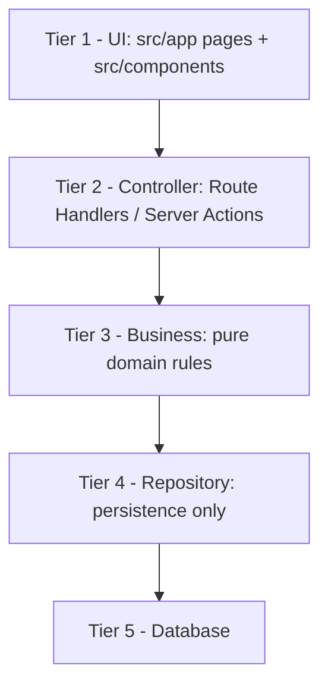
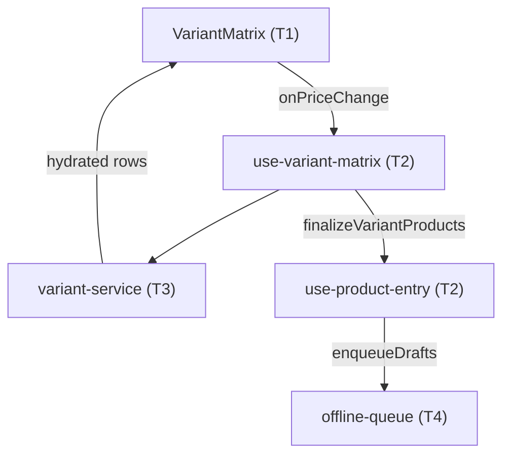
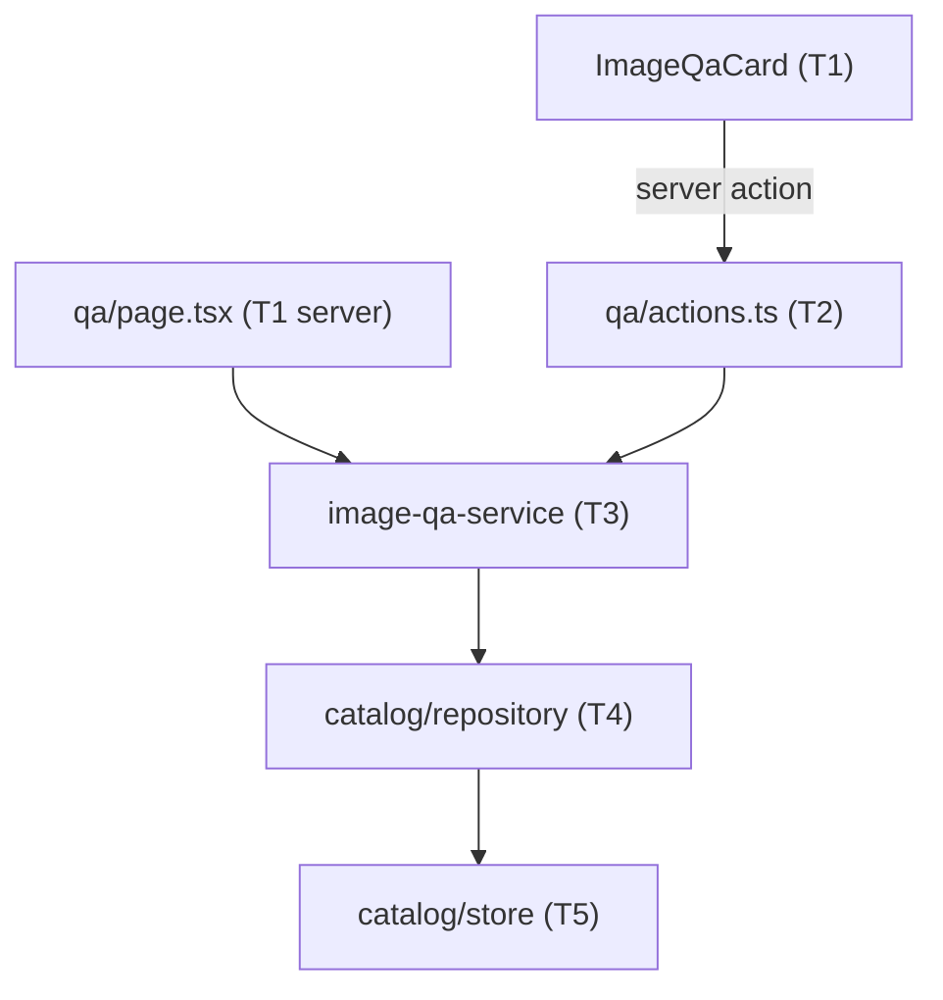
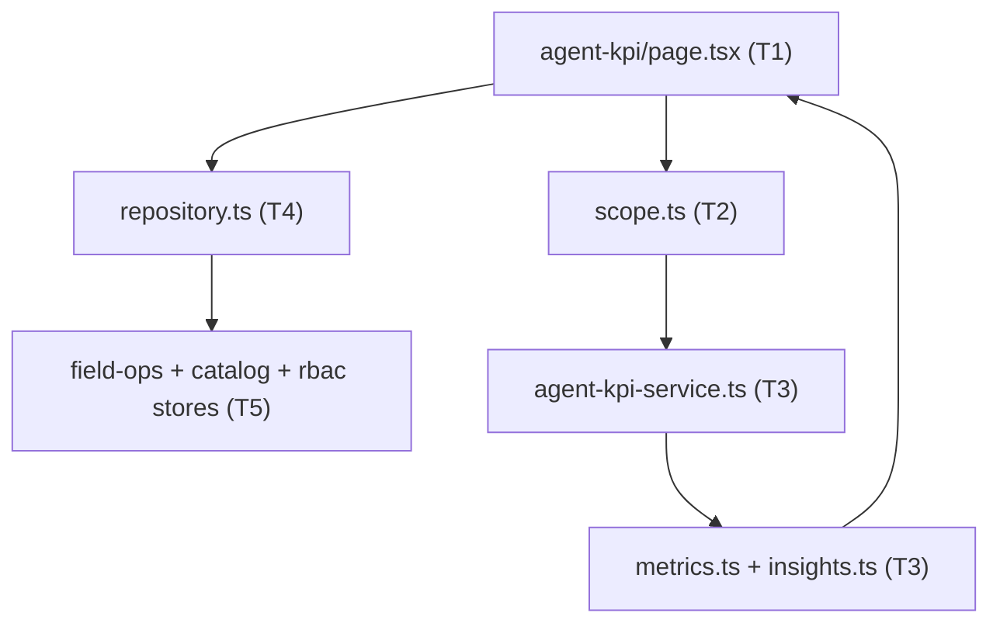

# Kanjo V2.0 — Architecture Blueprint

Branch: `feat/v2-enterprise-architecture`
Stack: Next.js 15.5 App Router · React 19 · TypeScript 5.7 · Zod 3.24 · Headless UI 2.2 · Tailwind 3.4

This document is the single source of truth for **where code belongs**. Read it
before touching any module. `AGENTS.md` holds the mandatory rules; this file
holds the map and the migration status.

---

## 1. The Five Tiers

Requests flow strictly downward. A tier may only import from tiers **below**
it. Never import upward, never skip a tier.



| Tier | Responsibility | Location | May import |
|---|---|---|---|
| 1 — UI | Render, view state, handlers. No domain rules, no I/O. | `src/app/**/page.tsx`, `src/components/**`, `src/components/ui/**` | T2 |
| 2 — Controller | Auth/authorization, input validation (Zod), status codes, shaping responses. No business rules. | `src/app/api/**/route.ts`, `src/lib/auth/api.ts` | T3 |
| 3 — Business | Domain rules, invariants, calculations. Zero DB or UI imports. | `src/lib/<domain>/*.ts` | T4 (types only ideally) |
| 4 — Repository | Only layer that reads/writes a database. Doc mapping and queries. | `src/lib/<domain>/repository.ts`, `src/lib/<domain>/store/**` | T5 |
| 5 — Database | Hybrid: Supabase (PostgreSQL) for Financial/ERP, Firebase for Operations. Connecting clients live in `src/lib/db/`. | external + `src/lib/**/data/seed.ts` | — |

### Tier rules in practice

- A controller route does: `authorizeAny([...])` → `schema.parse()` →
  `businessFn()` → `NextResponse.json()`. Nothing else.
- A component never calls `fetch("/api/...")` inline; it lives in a
  `use-*.ts` hook under the same domain folder.
- Domain functions are synchronous where possible and throw typed errors
  (`CatalogError`, `FieldOpsError`) that the controller maps with `apiError()`.

### Hybrid Database Strategy

Two databases, chosen by domain, never by convenience:

| Domain | Database | Tier 5 clients |
|---|---|---|
| Financial / ERP — users, RBAC, ledgers, wallets, commissions | Supabase (PostgreSQL) | `src/lib/db/supabase/{config,client,server}.ts` |
| Operations — live order tracking, complex catalog, offline-first field data | Firebase (Firestore) | `src/lib/db/firebase/{config,client,admin}.ts` |

- A repository talks to exactly one database. Cross-domain reads are composed
  one tier up (Tier 3), never with a SQL join against Firestore.
- `src/lib/db/supabase/server.ts` and `src/lib/db/firebase/admin.ts` import
  `server-only`; importing either from a client component is a build error.
- `firebase-admin` cannot run on the Edge Runtime. A controller that uses it
  MUST declare `export const runtime = "nodejs"`. All other routes stay `edge`.
- Configuration is read lazily inside the getters, so `next build` and
  `/login` succeed even when no database secrets are configured.

**Decision: Supabase is the committed SQL engine for Financial/ERP.** Its
PostgreSQL foundation gives real transactions, constraints and referential
integrity for ledgers, wallets and commissions, and its real-time channel keeps
wallet/commission balances live without polling. Firebase is not a candidate
for this domain.

---

## 2. Master Rules (summary of `AGENTS.md`)

1. **Small files** — hard limit 250–300 lines per `.ts`/`.tsx`. Generated data
   is the only exception and must live in `src/lib/**/data/`.
2. **Single responsibility** — layout, state, business logic and API access are
   separate modules.
3. **CSS modularity** — `src/app/globals.css` is an `@import` manifest plus
   global resets only. Domain CSS lives in `src/styles/<domain>.css`, tokens
   first.
4. **Refactor before extend** — touching an over-limit file requires a pure
   extraction commit first, verified by `typecheck` + `build`.
5. **Design system** — never use native `<button>`, `<input>`, `<select>` or
   raw Tailwind dropdowns. Use the primitives in `src/components/ui/`.
6. **Verification** — every refactor commit must pass `npm run typecheck` and
   `npm run build` (dev server must be stopped for the build).
7. **Production UI only** — never render architectural explanations,
   implementation notes, stack names, env var names, or placeholder/"dummy"
   paragraphs in React components. The DOM is for the end user: labels, values,
   states, and actions. Rationale, trade-offs and backend mechanics belong in
   `ARCHITECTURE.md`, code comments, or commit messages. If a reviewer would say
   "why is this text in the product?", delete it.

Full text: `AGENTS.md`.

---

## 3. Environment & Configuration

All variables are read lazily by `src/lib/db/env.ts` and the domain config
modules, so a missing value fails at first use — never at import or build time.
Set them in Cloudflare Pages under **Settings → Variables and Secrets**; mark
every secret as encrypted.

### Required today (application boot)

| Key | Scope | Secret | Used by |
|---|---|---|---|
| `SESSION_SECRET` | Runtime | Yes | HMAC-SHA256 session cookie signing. Must be ≥ 16 chars; production throws otherwise. `src/lib/auth/session.ts` |

`NODE_ENV` is supplied by Next.js / Cloudflare — never configure it manually.

### Required once the Financial/ERP repositories are wired (Supabase)

| Key | Scope | Secret | Used by |
|---|---|---|---|
| `SUPABASE_URL` | Runtime | No | Project REST endpoint, e.g. `https://<ref>.supabase.co` |
| `SUPABASE_ANON_KEY` | Build + Runtime | No (public) | `getSupabaseBrowserClient()`; `signInWithPassword()` during login |
| `SUPABASE_SERVICE_ROLE_KEY` | Runtime | Yes | `getSupabaseServerClient()` — RLS-bypassing Tier 4 reads/writes, auth admin |

Login needs **all three**. The anon key verifies the password; the service-role
key reads the profile back from `app.users`. Missing any of them goes to
`/login?error=login-disabled` rather than silently falling back to the seed
roster.

The service-role key must never be prefixed with `NEXT_PUBLIC_`. It is used by
`app/api/admin/users/provision` to mint auth users, so leaking it would let
anyone create an operator account.

**Public signup must be disabled on the Supabase project.** Turn off email and
phone signups (Dashboard → Authentication → Sign In / Providers, or
`auth.enable_signup = false` in `supabase/config.toml`). Signup is not a product
feature here: accounts are provisioned top-down only (§7.6). If the flag is
left on, `POST /auth/v1/signup` remains reachable and would mint credential-only
accounts with no `app.users` profile, no grants, and no city scope.

### Required once the Operations repositories are wired (Firebase)

| Key | Scope | Secret | Used by |
|---|---|---|---|
| `NEXT_PUBLIC_FIREBASE_API_KEY` | Build + Runtime | No (public) | `getFirebaseWebConfig()` |
| `NEXT_PUBLIC_FIREBASE_AUTH_DOMAIN` | Build + Runtime | No (public) | `getFirebaseWebConfig()` |
| `NEXT_PUBLIC_FIREBASE_PROJECT_ID` | Build + Runtime | No (public) | `getFirebaseWebConfig()` |
| `NEXT_PUBLIC_FIREBASE_STORAGE_BUCKET` | Build + Runtime | No (public) | `getFirebaseWebConfig()` |
| `NEXT_PUBLIC_FIREBASE_MESSAGING_SENDER_ID` | Build + Runtime | No (public) | `getFirebaseWebConfig()` |
| `NEXT_PUBLIC_FIREBASE_APP_ID` | Build + Runtime | No (public) | `getFirebaseWebConfig()` |
| `NEXT_PUBLIC_FIREBASE_MEASUREMENT_ID` | Build + Runtime | No (public) | Optional analytics |
| `NEXT_PUBLIC_FIREBASE_APP_CHECK_SITE_KEY` | Build + Runtime | No (public) | Optional App Check |
| `FIREBASE_PROJECT_ID` | Runtime | No | `getFirebaseProjectId()`, admin app |
| `FIREBASE_CLIENT_EMAIL` | Runtime | Yes | Admin credential (when not using the JSON blob) |
| `FIREBASE_PRIVATE_KEY` | Runtime | Yes | Admin credential; literal `\n` sequences are restored |
| `FIREBASE_SERVICE_ACCOUNT` | Runtime | Yes | Alternative: full service-account JSON as one value |

`NEXT_PUBLIC_*` values are inlined at build time, so changing one requires a
redeploy, not just a restart. The Admin SDK variables are only needed by routes
declared `runtime = "nodejs"`.

### Do not add to the Pages environment

`FIREBASE_API_KEY`, `FIREBASE_AUTH_DOMAIN`, `FIREBASE_STORAGE_BUCKET`,
`FIREBASE_MESSAGING_SENDER_ID`, `FIREBASE_APP_ID`, `FIREBASE_MEASUREMENT_ID`,
`FIREBASE_APP_CHECK_SITE_KEY`, `KANJO_DRIVE_SCRIPT_URL`,
`KANJO_DRIVE_SCRIPT_TOKEN` belong to the legacy static site in `public/` and
its build scripts. The `SYNC_DRY_RUN` / `DRY_RUN` / `BACKUP_PATH` /
`CLAIMS_WRITE_DELAY_MS` family belongs to the GitHub Actions maintenance
scripts. Neither group is read by the Next.js app.

---

## 4. UI Primitive Library — `src/components/ui/`

All Headless UI backed. Brand styling lives inside each primitive via `data-*`
states; call sites never hand-roll purple/gold classes.

| File | Lines | Exports | Use for |
|---|---|---|---|
| `button.tsx` | 57 | `Button` | Every action / submit |
| `dropdown-menu.tsx` | 99 | `DropdownMenu` | Row and context actions |
| `tabs.tsx` | 97 | `Tabs` | Section / filter switchers |
| `form-inputs.tsx` | 234 | `Field`, `TextField`, `TextAreaField`, `CheckboxField`, `ToggleField`, `InputControl` | Form controls |
| `select-menus.tsx` | 237 | `SelectMenu`, `ComboField` | Selects and searchable pickers |
| `chip-toggle.tsx` | 33 | `ChipToggle` | Multi-select chips |
| `page-header.tsx` | 24 | `PageHeader` | Page titles |
| `stat-card.tsx` | 19 | `StatCard` | KPI tiles |
| `skeletons.tsx` | 183 | skeleton set | Loading states |
| `cx.ts` | 4 | `cx` | Class merge helper |

Aesthetic contract: rounded-full pills for tabs and menu triggers, rounded-lg
inside menu panels, high-contrast purple focus/open/hover states
(`--kanjo-interactive-hover` + white text, never white-on-white), soft shadows,
interactive-purple / gold accents. Selected tabs use the interactive purple with
white text (AA) so contrast never depends on the pastel wash alone. Dark mode is
driven by `data-theme="dark"` on `<html>` (see `tailwind.config.ts` `darkMode`
selector).

### Primitive rule: every `Label` needs a provider

Headless UI's `Label`, `Description` and `Switch.Label` read from a React
context. Rendering one without a parent that supplies it throws at render time
and takes down the whole route:

> `You used a <Label /> component, but it is not inside a relevant parent.`

This string comes from `@headlessui/react`, not from Recharts, even when the
crashing route happens to contain charts. Rules:

- Wrap labelling in `Field` (which renders Headless UI `Field`), or inside
  `Listbox` / `Combobox` / `Switch.Group`. Never render a bare `Label`.
- `Field` must stay a `HeadlessField`; downgrading it to a `<div>` re-breaks
  every `SelectMenu` that passes a `label`, including `/agent-kpi`.
- A primitive that takes a `label` prop owns the provider, so call sites cannot
  get this wrong.

---

## 5. Current Module Placement

### Database Clients (Tier 5)
- `src/lib/db/env.ts` — `optionalEnv`, `requireEnv`, `requireAnyEnv`,
  `MissingEnvError`. Every client resolves configuration through this module.
- `src/lib/db/supabase/config.ts` — lazy `SUPABASE_*` readers + `hasSupabaseConfig`.
- `src/lib/db/supabase/client.ts` — anon-key browser client (RLS enforced).
- `src/lib/db/supabase/server.ts` — service-role client for Tier 4 Financial/ERP
  repositories. `server-only`.
- `src/lib/db/firebase/config.ts` — lazy `NEXT_PUBLIC_FIREBASE_*` readers.
- `src/lib/db/firebase/client.ts` — memoised web app + Firestore with persistent
  cache and an in-memory fallback when IndexedDB is unavailable.
- `src/lib/db/firebase/admin.ts` — service-account Admin SDK for Operations
  writes. `server-only`; Node runtime only.
- `supabase/migrations/20261029000000_rbac_foundation.sql` — the validated
  `app` schema (RBAC tables, triggers, RLS). See Section 7.

Status: the clients exist, but **no domain repository consumes them yet**. The
in-memory stores below remain the live implementation until each domain is
migrated one at a time.

### Auth & RBAC (T1→T5)
- `src/lib/auth/api.ts` — `authorize`, `authorizeAny`, `apiError`, `readJson` (Controller helpers).
- `src/lib/auth/login.ts` — `resolveLoginRequest` / `safeNextPath`: verifies phone + password via `signInWithPassword`, then mints the app session. Never calls `redirect()`.
- `src/app/login/login-form.tsx` — phone + password form (client).
- `src/app/login/page.tsx` — login container.
- `src/app/api/auth/login/route.ts` — `POST` login Route Handler; sets the cookie and returns `NextResponse.redirect`.
- `src/app/api/auth/logout/route.ts` — `POST` logout Route Handler; clears the cookie and redirects.
- `src/lib/auth/server-session.ts` — `getServerSession()` and cookie I/O.
- `src/lib/auth/guard.ts` — `requireSession`, `requirePermission` (server components).
- `src/lib/auth/session.ts` — HMAC token encode/verify.
- `src/lib/rbac/` — `permissions.ts` (38 keys / 9 groups), `users.ts` (async facade), `repository.ts` (Tier 4 Supabase reads/writes), `seed-users.ts` (fallback only), `modules.ts`, `hierarchy.ts` (clearance + scope rules), `management.ts` (`assertCanCreate` / `assertCanPatch`).
- `src/lib/rbac/services/provisioning-service.ts` — `createUserAccount()`; top-down signup via `auth.admin.createUser`. See §7.6.
- `src/lib/schemas/provisioning.ts` — `provisionAccountSchema` (E.164 phone, password 8–72, clearance, grants, cities).
- `src/app/api/admin/users/provision/route.ts` — `POST` provisioning controller (nodejs runtime, `manage_permissions`).
- `src/lib/city-scope*.ts` — `effectiveCityIds`, `canAccessCity`, `scopedCities`.

**Public signup is disabled.** No signup route or `signUp()` call exists; accounts are only created top-down by an authorised operator (§7.6).

#### Why login is a Route Handler, not a Server Action

`next-on-pages` cannot resolve `redirect()` inside an Edge Server Action; it
throws `Invariant: Missing initURL` and the POST returns HTTP 500. Login and
logout therefore POST to plain route handlers. Rules locked in:

- **Never call `redirect()` from a Server Action on this branch.** Return a path
  and let the caller navigate, or use a Route Handler.
- The handlers build an absolute redirect URL from `x-forwarded-host` /
  `x-forwarded-proto`, because Cloudflare terminates TLS upstream and the
  internal request URL carries the wrong origin.
- `safeNextPath` rejects `//host` and absolute URLs, so `?next=` cannot be used
  as an open redirect.
- `src/app/login/actions.ts` is a deprecated, redirect-free shim; the forms now
  target `/api/auth/login` and `/api/auth/logout` directly.


### Catalog (Tier 1–5)
- UI: `src/components/catalog/` (`catalog-client` 121, `product-card` 133,
  `product-form` 256, `cascading-taxonomy` 164, `use-product-entry` 270,
  `draft-list-item`, `draft-queue-banner`, `variant-matrix`, filter tabs).
- Controller: `src/app/api/catalog/products/`, `+ [id]/image-qa`, `+ sync`, and
  the QA server actions in `src/app/(workspace)/catalog/qa/actions.ts`.
- Business: `src/lib/catalog/services/variant-service.ts` (variant algebra) and
  `services/image-qa-service.ts` (image review state machine + city scope), plus
  `filters.ts`, `sku.ts`, `category.ts`, `draft-types.ts`. `variants.ts` and
  `image-qa.ts` are deprecated shims over the services.
- Data access: `src/lib/catalog/offline-queue.ts` (draft queue) over
  `draft-storage.ts` (IndexedDB/localStorage); `draft-queue.ts` is a shim.
- Repository: `src/lib/catalog/store.ts` (279) — in-memory store + CRUD/sync;
  `src/lib/catalog/repository.ts` — merchant-city resolution + QA commits.
- Data: `src/lib/catalog/data/seed.ts` (85).
- Schema: `src/lib/schemas/catalog.ts`.
- State enum: `draft → pending_review → completed → published`.
- Image QA gated by `manage_catalog | review_catalog_images`; drafts edit gated
  by `manage_catalog | create_products`.
- QA workspace lives at `/catalog/qa` (nav module `review_catalog_images`).

### Field Ops (Tier 1–5)
- UI: `src/components/field-ops/` (client shells, modals, visit engine, geo
  panel). Note: `field-ops-client.tsx` (831) and `cities-client.tsx` (760)
  exceed the limit — see backlog.
- Controller: `src/app/api/field-ops/**` (board, cities + managers,
  merchants + documents/edit-requests/reports/state/transfers, search, tasks,
  transfers, visits/sync, edit-requests), plus `geo-intelligence` and `session`.
- Business: `src/lib/field-ops/` — `offline-queue.ts`, `types.ts`,
  `firestore.ts` (doc mappers).
- Repository: `src/lib/field-ops/store.ts` is a barrel over
  `store/core.ts` (store accessor, ids, clock) and `store/operations.ts`.
  The concrete repositories are `store/{cities,merchants,tasks,visits,transfers,
  edits,documents,state,crm,dates}.ts`; `store/seed.ts` (565) is seed data.
- Legacy in-memory global store guarded by `__kanjoV2FieldOpsStore`.

### Taxonomy (Tier 1–5)
- UI: `src/app/(workspace)/catalog/taxonomy/taxonomy-center.tsx` (764 — over
  limit).
- Controller: `src/app/api/taxonomy/**` (entries, requests, approve, reject).
- Repository: `src/lib/taxonomy/store.ts` (707 — over limit);
  `src/lib/taxonomy/data.generated.ts` (2219 — allowed, generated).

### BI / Overview (Tier 1 + 3)
- UI: `src/app/(workspace)/overview/`, `src/components/` charts.
- Business: `src/lib/bi/` — `dataset.ts` (190), `select.ts`, `tables.ts`,
  `drill.ts`, `export.ts`, `format.ts`, `mock.ts`, `types.ts`.
- BI folds Field Ops review states into the `draft` bucket for reporting.
- Charts guard their own empty state. `FunnelStageChart` skips Recharts when
  every slice is `0`, and `ComplianceDonut` when every `complete` is `0`,
  rendering `.bi-chart-empty` / `.bi-donut-empty` instead. Never mount a
  `Funnel`/`Pie` with `LabelList`/`Cell` children over zero rows.

### Agent KPI (Tier 1–5)
- UI: `src/app/(workspace)/agent-kpi/page.tsx` (server container) plus
  `components/{kpi-filter-bar,kpi-agent-card,kpi-metric-grid,kpi-rank-card,kpi-insights-panel}.tsx`.
- Controller: page-level authorization (`view_agent_kpi`), URL filter parsing
  (`parseKpiFilters`), and scope resolution (`resolveKpiScope`). Reps are pinned
  to themselves; admins (`globalScope` or clearance ≥ 3) may filter city/team/rep.
- Business: `src/lib/kpi/services/agent-kpi-service.ts` (snapshots, city-scoped
  rank, top-performer), `metrics.ts` (stage arithmetic + scoring),
  `insights.ts` (gap heuristics), `scope.ts` (filter/scope rules). All pure.
- Repository: `src/lib/kpi/repository.ts` composes field-ops + catalog + RBAC
  stores into a `KpiDataset`. No math, no authorization.
- Data: `src/lib/kpi/data/facts-seed.ts` stands in for the Consumer shift/GMV
  and app-usage feeds until those systems publish an API.
- Ranking is **strictly city-scoped**; scores from different cities are never
  compared. Metrics are chosen from the city stage:
  `preparation → contracting → data_entry → live_operations`.
- CSS: `src/styles/kpi.css` manifest over `src/styles/kpi/{layout,metrics,ranking,insights,responsive}.css`.

### CSS
- Manifest: `src/app/globals.css` (4884 lines — still over limit, extraction backlog).
- Domains: `src/styles/{tokens,bi,catalog,kpi,field-ops-actions,rbac}.css` plus
  `catalog/*` (cards, controls, form, matrix, qa, responsive) and `bi/*`
  (charts, layout, negotiation, overlay, responsive, stats).

---

## 6. Migration Gaps (target end-state)

The tiers exist conceptually; these are the concrete gaps to close.

1. **In-memory stores are still the live Tier 5.** Every domain
   (`rbac/users.ts`, `catalog/store.ts`, `field-ops/store/`, `taxonomy/store.ts`,
   `kpi/repository.ts`) reads a process-local global. On Cloudflare these are
   per-isolate, so data is neither durable nor consistent across requests. The
   connection clients now exist in `src/lib/db/`; the remaining work is to move
   each domain behind a `repository.ts` that uses them, one domain per commit:
   - Financial/ERP → Supabase: RBAC users, ledgers, wallets, commissions.
   - Operations → Firebase: catalog, field ops, live orders.
2. **RBAC reads and writes are now Supabase-backed.** `rbac/repository.ts`
   implements the Tier 4 seam and `rbac/users.ts` is an async facade over it.
   The seed roster is consulted only when Supabase is not configured; once it
   is, a missing row means "no such operator" rather than a demo fallback.
   Password login uses `signInWithPassword`. Remaining: the write paths in
   `field-ops/store/cities.ts` still mutate the in-memory city store alongside
   RBAC grants, so a grant can succeed while the city assignment is process-local.
3. **Two create paths coexist.** `POST /api/admin/users` still calls the
   seed-only `createUser()`, which now throws when Supabase is configured;
   `POST /api/admin/users/provision` is the real one. The admin UI still posts
   to the former, so account creation from the UI is broken until it is
   repointed at the provisioning endpoint.
4. **Repository seams are partially created.** `catalog/repository.ts`,
   `kpi/repository.ts` and `rbac/repository.ts` exist. `field-ops` and
   `taxonomy` still mix business rules with persistence.
5. **Service extraction started.** `src/lib/catalog/services/` now holds the
   variant and image-QA services, and `src/lib/catalog/repository.ts` is the
   reserved Tier 4 seam. Other domains still mix business and persistence in
   `src/lib/<domain>/store.ts`; extract pure rules into
   `src/lib/<domain>/services/` and leave only queries in `store/`.
6. **`catalog/store.ts` mixes validation (T3) with mutation (T4).** Split into
   `catalog/rules.ts` and `catalog/repository.ts`.
7. **`taxonomy/store.ts` (707)** holds business decisions (approve/reject) and
   persistence together. Split and drop below 300.
8. **Page components are still clients.** Move view state into `use-*.ts` so
   `page.tsx` stays a server container.
9. **Files over the 300-line limit (backlog):**
   - `src/components/field-ops/field-ops-client.tsx` — 831
   - `src/app/(workspace)/catalog/taxonomy/taxonomy-center.tsx` — 764
   - `src/components/field-ops/cities-client.tsx` — 760
   - `src/lib/taxonomy/store.ts` — 707
   - `src/lib/field-ops/store/seed.ts` — 565
   - `src/components/field-ops/request-modals.tsx` — 506
   - `src/lib/field-ops/types.ts` — 449
   - `src/lib/geo/egypt.ts` — 426
   - `src/lib/field-ops/offline-queue.ts` — 344
   - `src/components/field-ops/ops-team-panel.tsx` — 327
   - `src/app/globals.css` — 4884 (extract to `src/styles/<domain>.css`)
10. **Business rules need negative-space tests.** Domain functions are pure;
   add unit coverage before wiring new persistence.
11. **Schema has no automated test.** The RBAC migration was validated by hand
   against PostgreSQL 15. Port those checks into a repeatable SQL or pgTAP
   suite so the governor invariant cannot silently regress.

Generated data exception: `src/lib/taxonomy/data.generated.ts` is the only file
allowed above the limit.

---

## 7. Data Persistence — Hybrid Schema Contract

Tier 5 is deliberately split between two systems. Nothing may be stored in both.

| Concern | System | Why |
|---|---|---|
| Identity, RBAC, city scope | Supabase (PostgreSQL) | Transactional, foreign keys, auditable writes |
| Contracts, wallets, ledgers, commissions | Supabase (PostgreSQL) | ACID money movement; a lost write is a financial incident |
| Catalog, merchants, tasks, visits, city geometry | Firebase (Firestore) | Offline-first writes, realtime sync, GeoJSON payloads |
| Taxonomy | Firebase (Firestore) | Grows without migrations; edited by field staff |

Rule: any entity that participates in a money movement or an authorization
decision is SQL. Anything that is primarily edited offline in the field is
NoSQL. A document never spans both stores.

### 7.1 RBAC Schema

Source of truth for the TypeScript side stays `src/lib/rbac/`. The database
mirrors it, it does not redefine it: `app.permissions` seeds from
`permissions.ts` (38 keys, 9 groups), and `app.users.clearance_level` follows
`hierarchy.ts` (1–4).

The migration lives at `supabase/migrations/20261029000000_rbac_foundation.sql`.
It creates the `app` schema, four tables, three triggers, two RLS helpers, and
policies. It is validated end-to-end against PostgreSQL 15.

| Table | Purpose |
|---|---|
| `app.permissions` | Capability catalogue, one row per key |
| `app.users` | Operator profile + authorization state |
| `app.user_permissions` | Explicit capability grants (no roles table) |
| `app.user_city_scope` | Per-operator city restriction |

Load order is `permissions` → `users` → `user_permissions` → `user_city_scope`.

### 7.2 Identity: phone + password, and nothing else

Login is **phone number + password**. Email is optional profile data and is
therefore neither required nor unique.

- Credentials are owned by Supabase `auth.users`. Kanjo never stores a password
  hash of its own; there is no custom password column anywhere in `app`.
- `app.users.id` is a foreign key to `auth.users.id`, and `app.users.phone`
  mirrors `auth.users.phone` through the `auth_user_upsert_profile` trigger.
- Phone is constrained to E.164 (`^\+[1-9][0-9]{7,14}$`) and is unique.
- The same trigger raises `AUTH_PHONE_REQUIRED` if an auth user appears without
  a phone, so a phone-less account can never be created.
- `email` accepts NULL and carries no unique index. Duplicate emails are legal.

### 7.3 Authorization invariants enforced in SQL

These mirror the pure functions in `src/lib/rbac/`, so the rules hold even if a
write bypasses the application.

| Invariant | Mechanism |
|---|---|
| `global_scope` never drifts from clearance | `generated always as (clearance_level >= 3) stored` |
| Clearance stays within 1–4 | `users_clearance_range` check |
| At least one active `manage_permissions` holder | Deferred constraint triggers on `app.user_permissions` and `app.users` |
| Ordinary profile edits stay legal | Guards fire only on governor-removal events, so the first operator can be bootstrapped |
| Stale sessions can be invalidated | `auth_revision` counter |

The governor guard is the SQL twin of `assertActiveGovernor()` in
`src/lib/rbac/users.ts`. It rejects removing or deactivating the last active
governor, but permits any unrelated update — an earlier draft fired on every
update and made bootstrapping the first operator impossible.

### 7.4 Cross-database reference

`app.user_city_scope.city_id` has **no foreign key**. City documents live in
Firestore, so referential integrity is a Tier 3 responsibility. The column is
`text` and is validated only as non-empty at the database layer.

### 7.5 Row Level Security

All four tables have RLS enabled *and* forced, so even the table owner is
subject to policy. `has_permission()` and `is_active_user()` are
`security definer` to avoid a policy on `app.users` recursing into itself.

| Surface | Policy |
|---|---|
| `app.permissions` | Read by any active operator; writes are service-role only |
| `app.users` | Read own row, or all rows with `manage_permissions`; writes are governor-only |
| `app.user_permissions` | Read own grants (needed to build a session), or all with `manage_permissions` |
| `app.user_city_scope` | Same shape as grants |

Self-service profile edits must go through a dedicated RPC rather than a direct
`UPDATE`, so a user can never raise their own `clearance_level` or flip `active`.

### 7.6 No Self-Service Signup — Top-Down Provisioning

**Public registration is strictly disabled.** There is no signup route, no
`signUp()` call anywhere in the app, and no "create account" link on `/login`.
An account can only come into existence when an authorised operator mints it.
Kanjo is B2B operations software, not a consumer product: every identity is
issued by someone who is accountable for it.

Supabase's phone provider must stay closed to public signup. Set
`auth.enable_signup = false` (Dashboard → Authentication → Providers, or
`supabase/config.toml`) so the only remaining path is the Admin API used by
Tier 3. Without that setting the REST `/auth/v1/signup` endpoint would still
mint accounts behind the app's back.

#### The hierarchy

Provisioning follows clearance, and each level can only create *strictly
below* itself:

| Actor | Level | Creates | Scope it may grant |
|---|---|---|---|
| System Admin / Founder | 4 / 3 | Anyone below | Any city, any permission it holds |
| City Operations Manager | 2 | Field Reps (level 1) | Only their own cities |
| Field Rep | 1 | Nobody | — |

Rules enforced for every creation, in both Tier 3 and SQL:

1. **Strictly lower rank.** `actor.clearanceLevel > target.clearanceLevel`.
   Equal or higher rank is refused, so peers cannot clone each other and
   nobody self-escalates.
2. **Permission subset.** The grantor can only hand out permissions they
   themselves hold (`permissionsAreWithinActor`). No capability can be
   invented during provisioning.
3. **City subset.** A non-global actor can only assign cities from their own
   `accessibleCities`. Global actors (level ≥ 3) may assign any city.
4. **Global ranks are executive-only.** Levels 3–4 require a global actor.

These live in `assertCanCreate()` in `src/lib/rbac/management.ts` and are
already covered by the hierarchy helpers.

#### The write path

All four writes happen server-side; the service-role key never leaves the
server.

```
POST /api/admin/users/provision        (protected Route Handler, edge)
  → getServerSession()                 verify cookie + re-read live grants
  → require manage_permissions         else 401 / 403
  → provisionAccountSchema.parse()     E.164 phone, password 8–72 chars
  → assertCanCreate(session, input)    rank / permission / city subset
  → supabase.auth.admin.createUser()   SERVICE ROLE, phone + password
      ├─ trigger: app.handle_auth_user_upsert mirrors phone/email
      ├─ update app.users                profile: name, title, team, clearance
      ├─ insert app.user_permissions     explicit capability grants
      └─ insert app.user_city_scope      city assignments
  → on any failure: auth.admin.deleteUser()  cascade rollback
```

Implementation:

- `src/lib/schemas/provisioning.ts` — `provisionAccountSchema`. Phone is E.164;
  password is capped at 72 characters because bcrypt silently truncates beyond
  that, and a silent truncation would make the stored credential differ from
  what the operator typed.
- `src/lib/rbac/services/provisioning-service.ts` — `createUserAccount()`. Pure
  orchestration over the service-role client; no UI, no HTTP concerns.
- `src/app/api/admin/users/provision/route.ts` — thin controller. It only
  authenticates, delegates, and maps errors to status codes.

The handler declares `runtime = "edge"`. `auth.admin.*` works there because
`@supabase/supabase-js` is fetch-based; a route left on the Node runtime breaks
`next-on-pages`, which requires every route to opt into Edge. Do not call
`redirect()` here — see §5 on `next-on-pages`.

#### Deployment prerequisites

Three project-level settings are required; none of them live in application code.

1. **Expose the `app` schema to PostgREST.** The service writes through
   `.schema("app")`, which only resolves if `app` is listed under
   Dashboard → API → Exposed schemas (or `schemas = ["public", "app"]` in
   `config.toml`). Without it every write fails with *The schema must be one of
   the following*. Exposing `app` is safe: RLS is forced and the policies only
   admit `authenticated` or `service_role`.
2. **Grant `service_role` table privileges.** The foundation migration grants
   `authenticated` only, so `20261029000100_rbac_service_role_grants.sql` adds
   `usage` plus DML on the four `app` tables for `service_role`. `service_role`
   also carries `BYPASSRLS` on Supabase, which is what makes the provisioning
   writes succeed despite the forced policies.
3. **Seed `app.permissions`.** `user_permissions.permission_key` is a foreign
   key, so provisioning fails until the 38 keys from `permissions.ts` exist as
   rows. `20261029000200_seed_permissions.sql` seeds them idempotently from the
   live catalogue; run it before creating the first account.
4. **Keep the auth-mirror trigger outside RLS.** `app.users` uses
   `force row level security`, which applies even to the table owner. A
   `SECURITY DEFINER` function only escapes RLS when its owner holds
   `BYPASSRLS`; Supabase's migration-running role does not. When the foundation
   migration was applied by such a role, `app.handle_auth_user_upsert()` was
   rejected with *new row violates row-level security policy*, and GoTrue
   reported it only as `[unexpected_failure] Database error creating new user`
   (HTTP 500) — with no hint that RLS was involved. `20261029000300_fix_auth_mirror_rls.sql`
   grants the trigger's owning role explicit `insert`/`select`/`update`
   policies. The same migration adds `app.bootstrap_diagnostics()`, which
   reports the trigger owner, whether it bypasses RLS, whether RLS is forced,
   and the policy list, so this failure is self-explaining.

#### Bootstrapping the first Founder (chicken-and-egg)

Provisioning is governor-only, so the very first account cannot be created
through the UI. It is created out of band with
`scripts/bootstrap-founder.mjs`, which uses the Admin API:

```
node --env-file=.env.local scripts/bootstrap-founder.mjs
```

It is idempotent and re-convergent: it creates the auth user (or resets the
password on an existing phone), sets `clearance_level = 4`, and grants every row
in `app.permissions`. Granting all permissions does not violate the governor
invariant — the guard only blocks *removing* the last governor.

When the repository cannot be cloned locally, the same logic is available as
one temporary Edge route, `GET /api/admin/bootstrap`. It mints the credential
through the Admin API, sets level 4, and grants all 38 capabilities. Two safety
rails apply: the founder password is read from `BOOTSTRAP_PASSWORD` and never
committed, and the route refuses to run while another active governor exists,
so it cannot mint a second all-powerful account. Delete the route once the
founder can sign in — it is scaffolding, not a product surface.

**Never write directly into `auth.users`.** Supabase owns credential storage;
an INSERT there bypasses GoTrue's password hashing and its `auth.identities`
rows, yielding an account that cannot sign in. The Admin API is the supported
path and fires `app.handle_auth_user_upsert`. A SQL-only bootstrap is impossible
for the same reason: `encrypted_password` must be a GoTrue-compatible bcrypt
hash plus a matching identity row, which is implementation detail, not API.

#### Password login

Login is now real. `resolveLoginRequest()` in `src/lib/auth/login.ts`:

1. calls `supabase.auth.signInWithPassword({ phone, password })` with the anon
   key, so Supabase verifies the credential and Kanjo never sees a hash;
2. reads the profile back from `app.users` through the service-role repository;
3. refuses if the profile is missing or `active = false` — a valid Supabase
   credential with no authorisation row is not a valid operator;
4. mints the HMAC session cookie from the repository's grants and revision.

Login therefore requires **all three** Supabase variables (`URL`, `ANON_KEY`,
`SERVICE_ROLE_KEY`). With only the anon key, the profile read would fall back to
the seed roster and every correct password would fail, which is
indistinguishable from a wrong password. A missing configuration redirects to
`/login?error=login-disabled` instead.

The login page is a phone + password form (`login-form.tsx`). The demo roster
picker is gone, and `login.css` replaces the dead `.account-*` rules.

#### Failure handling

Provisioning is multi-step and must not leave a half-created account. The auth
user is created first, because `app.users.id` is a foreign key to
`auth.users.id`. If any profile, grant, or scope step fails, the auth user is
deleted; `on delete cascade` removes the dependent rows. Partial accounts are
therefore impossible, and the operator sees a retryable error rather than a
zombie login.

`granted_by` records the authorising operator for audit. It is set only when
the session id is a real UUID, because seed/demo sessions use `u-*` ids.

#### What replaces the old create flow

The existing `POST /api/admin/users` writes to the in-memory `createUser()`
store and collects an email. It stays until the RBAC repository lands, but it is
**not** the production path: it cannot mint credentials. `createUser()` should
gain a phone field and then delegate to `createUserAccount()` once the
repository reads `app.users`.

---

## 8. Refactored Modules

### Catalog — Smart Variant Matrix

The variant entry flow is the reference implementation of the five tiers.
Each tier owns exactly one concern:

| Tier | File | Responsibility |
|---|---|---|
| 1 — UI | `src/components/catalog/variant-matrix.tsx` | Dumb grid. Receives `selectedAttributes` + hydrated `rows` as props, renders name/SKU read-only and uses `InputControl` for the price only. Dispatches `onPriceChange(key, value)` upward. |
| 1 — UI | `src/components/catalog/product-form.tsx` | Presentation form. Consumes the controller hook; no domain math. |
| 2 — Controller | `src/components/catalog/use-variant-matrix.ts` | Derives view state (matrix → hydrated rows → selected labels) and memoises it. |
| 2 — Controller | `src/components/catalog/use-product-entry.ts` | Owns form state, validation order and save orchestration; calls the service, then the queue. |
| 3 — Business | `src/lib/catalog/services/variant-service.ts` | Pure and zero-dependency: `generateVariantMatrix`, `hydrateVariantCombinations`, `finalizeVariantProducts`. No React, no IndexedDB. |
| 4 — Data access | `src/lib/catalog/offline-queue.ts` | `enqueueDraft` / `enqueueDrafts` / `flushDrafts` + reads. Stores fully hydrated payloads only. |

Data flow:



Rules locked in by this refactor:

- Names (`base + attributes`) and SKUs (`KJ-<vendor>-<seed><seq>`) are produced
  once, in Tier 3, so the matrix and the queued draft can never disagree.
- The UI never imports from `src/lib/catalog/*` except read-only types and the
  hydrated row shape.
- `src/lib/catalog/variants.ts` and `src/lib/catalog/draft-queue.ts` are now
  deprecated re-export shims; new code imports the service / queue directly.

### Catalog — Image Quality Assurance (QA) Pipeline

The QA workspace proves the 5-tier model end-to-end with server actions.

| Tier | File | Responsibility |
|---|---|---|
| 1 — UI | `src/app/(workspace)/catalog/qa/page.tsx` | Server container: `requirePermission("review_catalog_images")`, calls the service, renders stats + board. |
| 1 — UI | `src/components/catalog/image-qa-board.tsx` | Client shell; owns lightbox state and message timeout only. |
| 1 — UI | `src/components/catalog/image-qa-card.tsx` | Dumb card: image, price, SKU and the three exits (تحميل / رفع المحسنة / اعتماد مباشر) built from `Button` + `DropdownMenu`. |
| 2 — Controller | `src/app/(workspace)/catalog/qa/actions.ts` | `"use server"` actions enforce RBAC, validate the data URL, call the service, `revalidatePath`. |
| 2 — Controller | `src/components/catalog/use-image-qa-board.ts` | Client glue: busy state, optimistic removal, `prepareImage` before upload. No domain rules. |
| 2 — Controller | `src/app/api/catalog/products/[id]/image-qa/route.ts` | Legacy REST entry point; same service + repository, same guards. |
| 3 — Business | `src/lib/catalog/services/image-qa-service.ts` | `ImageQaError`, `getPendingReviewProducts`, `approveImage`, `uploadEnhancedImage`, plus pure `assertImageQaTransition` / `applyImageQa`. Repository is injected — zero Tier 4 imports. |
| 4 — Repository | `src/lib/catalog/repository.ts` | `listCatalogRecords` / `findCatalogRecord` (merchant→city) and `commitImageQa`. Only layer that touches `catalog/store.ts`. |
| 5 — Database | `src/lib/catalog/store.ts` + `data/seed.ts` | In-memory global store and seed fixtures. **Target:** Firebase Firestore via `src/lib/db/firebase/` (catalog is an Operations domain). |

Data flow:



Rules locked in by this pipeline:

- `pending_review → completed` only; any other starting state raises
  `IMAGE_QA_NOT_PENDING` (verified: a replay returns 422).
- City scope is enforced twice: in the service (`getPendingReviewProducts`,
  `approveImage`, `uploadEnhancedImage`) and in the legacy route. An
  out-of-scope reviewer receives `PRODUCT_NOT_FOUND` (verified).
- RBAC: page and actions both require `manage_catalog | review_catalog_images`;
  a user without it is redirected to `/forbidden` (verified).
- All buttons in the QA surfaces use the `Button` primitive; row extras use
  `DropdownMenu`.

---

## 9. Agent KPI Dashboard — 4-Stage City Lifecycle

The dashboard is the second full 5-tier reference implementation (after Image
QA). The same rep is scored differently depending on the operational stage of
their city, because the work itself is different at each stage.

| Tier | File | Responsibility |
|---|---|---|
| 1 — UI | `agent-kpi/page.tsx` | Server container: `requirePermission("view_agent_kpi")`, builds dataset, resolves scope, renders cards. |
| 1 — UI | `components/kpi-filter-bar.tsx` | Client shell; writes city/team/rep/window into the URL. No math. |
| 1 — UI | `components/kpi-agent-card.tsx` | Layout: identity, stage rail, metric grid, usage strip, insights + rank. |
| 1 — UI | `components/kpi-metric-grid.tsx`, `kpi-rank-card.tsx`, `kpi-insights-panel.tsx` | Dumb presentational blocks. |
| 2 — Controller | `src/lib/kpi/scope.ts` | `parseKpiFilters`, `resolveKpiScope`, `buildKpiFilterOptions`, `isKpiAdmin`. Turns viewer + filters into a `KpiScope`. |
| 3 — Business | `src/lib/kpi/services/agent-kpi-service.ts` | `buildKpiReport`, `getAgentSnapshot`, `selectAgents`; computes 0-100 score and city rank. |
| 3 — Business | `src/lib/kpi/metrics.ts` | Pure stage arithmetic (`computeFacts`) and `scoreFacts`; `stageMetrics`/`usageMetrics` shape the UI contract. |
| 3 — Business | `src/lib/kpi/insights.ts` | `buildInsights` compares the agent with the city top performer. |
| 4 — Repository | `src/lib/kpi/repository.ts` | `loadKpiDataset` merges field-ops/catalog/RBAC into one dataset. |
| 5 — Database | field-ops/catalog stores + `kpi/data/facts-seed.ts` | Underlying records; the seed stands in for the consumer feeds. **Target:** Firebase for field ops and catalog; Supabase for financial KPIs. |

### Stage metric contract

| Stage | Metrics |
|---|---|
| Preparation (`preparation`) | merchants scouted, avg description length |
| Negotiation (`contracting`) | merchants visited, total visits, follow-ups, reports written, avg report length, target %, final contract %, provisional contract %, avg visit duration |
| Data entry (`data_entry`) | merchants digitized, total products, images uploaded, products missing images, catalog accuracy, avg description length |
| Live ops (`live_operations`) | daily shift orders, total GMV, tickets resolved, merchants contacted, rejected orders, active merchants, cash from merchants, cash from drivers |
| Global (all stages) | app usage: active minutes, active days, sessions, avg session |

### Rules locked in by this module

- **No cross-city ranking.** `rank.total` is always the count of agents whose
  `cityId` equals the subject's. A Giza rep is never compared to a Cairo rep.
- **Reps cannot widen scope.** `resolveKpiScope` ignores URL filters for a viewer
  without `globalScope`/clearance ≥ 3 and returns a self-only scope.
- **Stage drives metrics, not the viewer.** Metrics come from `agent.stage`
  (the city stage), so a Cairo rep and a Mansoura rep see different cards.
- **Controllers never compute.** The page passes a `KpiScope` to the service and
  renders `KpiSnapshot` objects verbatim.
- **Feed gap is explicit.** `scouts`/`liveOps`/`usage` are seeded fixtures until
  the Consumer app exposes shift/GMV tickets and usage tracking; replacing them
  only touches `repository.ts`.

Data flow:



---

## 10. The AI Workflow Loop (MANDATORY)

Every AI session on this branch follows this loop. No exceptions.

1. **Read first.** Before any code change, read `ARCHITECTURE.md` (this file)
   and `AGENTS.md`.
2. **Locate the tier.** Decide which tier(s) the task touches and confirm the
   target file is under the size limit. If it is over, the first commit is a
   pure extraction.
3. **Implement downward.** UI → Controller → Business → Repository. Respect the
   import direction.
4. **Verify.** Run `npm run typecheck` and `npm run build` (stop the dev server
   first).
5. **Update this file.** After every task that changes structure, module
   placement, primitives, or the migration gaps, edit `ARCHITECTURE.md` in the
   same change set. A task is not done until the document matches reality.
6. **Commit.** Conventional commit on `feat/v2-enterprise-architecture`; never
   amend a failed commit — fix forward.

If a rule and this document disagree, `AGENTS.md` wins; then update this
document.
