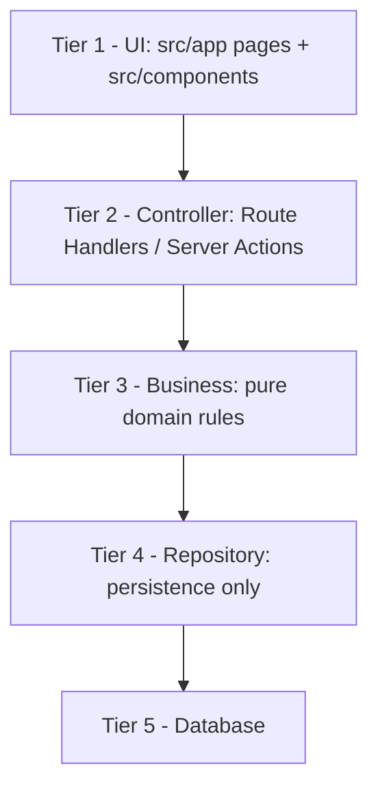
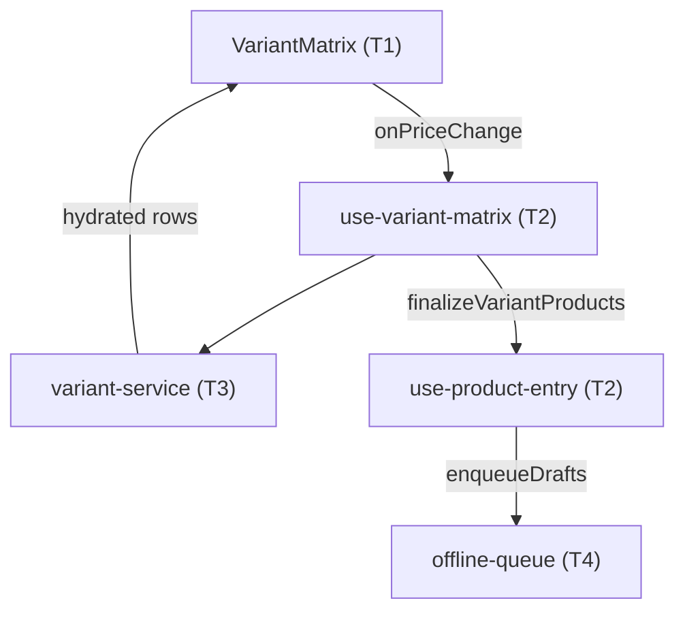
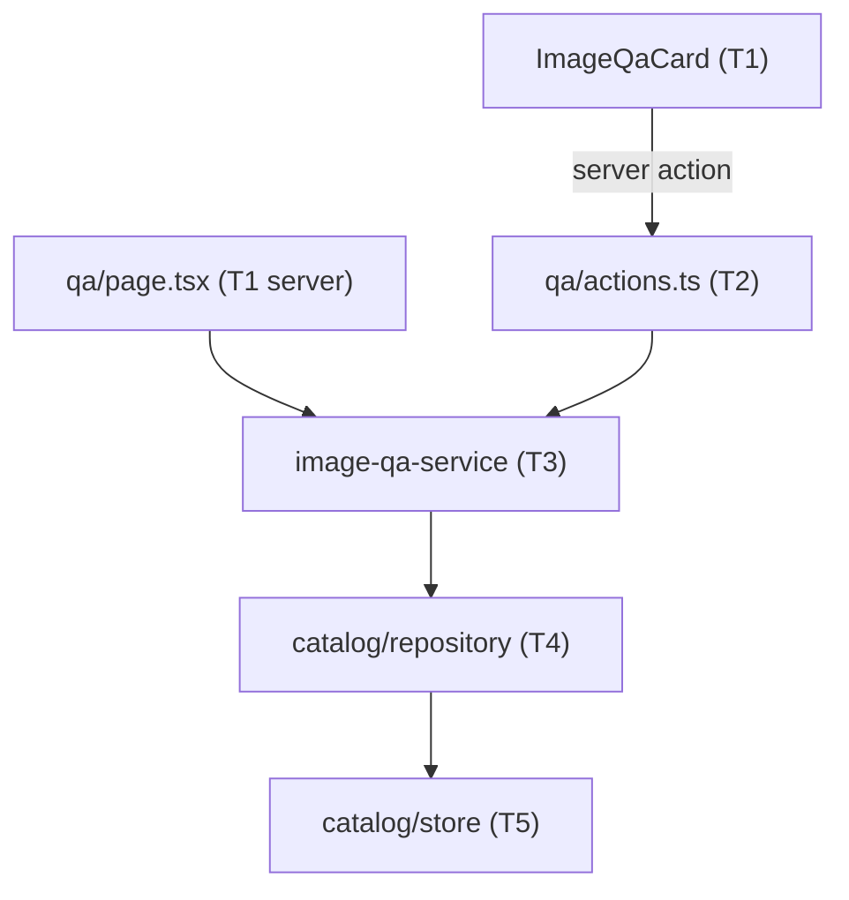
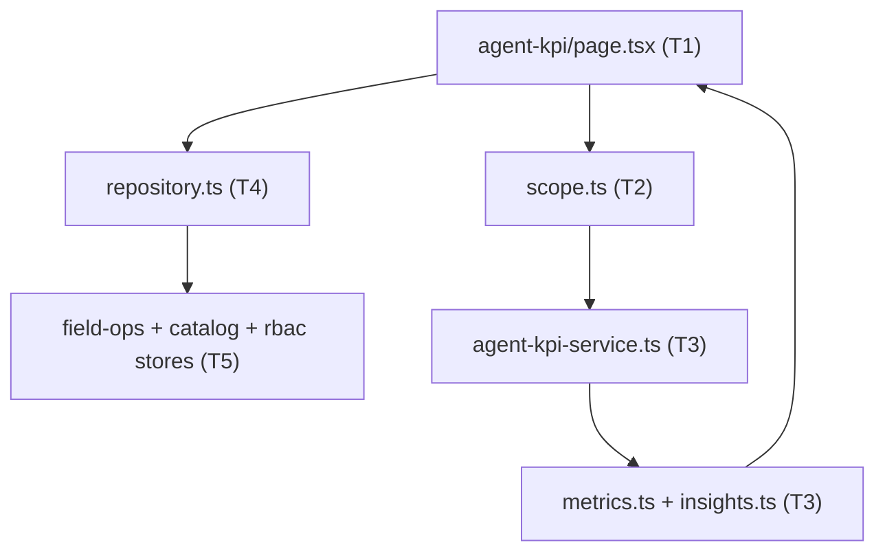

# Kanjo V2.0 — Architecture Blueprint

Branch: `feat/v2-enterprise-architecture`
Stack: Next.js 15.5 App Router · React 19 · TypeScript 5.7 · Zod 3.24 · Headless UI 2.2 · Tailwind 3.4

This document is the single source of truth for **where code belongs**. Read it
before touching any module. `AGENTS.md` holds the mandatory rules; this file
holds the map and the migration status.

---

## 1. The Five Tiers

Requests flow strictly downward. A tier may only import from tiers **below**
it. Never import upward, never skip a tier.

| Tier | Responsibility | Location | May import |
|---|---|---|---|
| 1 — UI | Render, view state, handlers. No domain rules, no I/O. | `src/app/**/page.tsx`, `src/components/**`, `src/components/ui/**` | T2 |
| 2 — Controller | Auth/authorization, input validation (Zod), status codes, shaping responses. No business rules. | `src/app/api/**/route.ts`, `src/lib/auth/api.ts` | T3 |
| 3 — Business | Domain rules, invariants, calculations. Zero DB or UI imports. | `src/lib/<domain>/*.ts` | T4 (types only ideally) |
| 4 — Repository | Only layer that reads/writes a database. Doc mapping and queries. | `src/lib/<domain>/repository.ts`, `src/lib/<domain>/store/**` | T5 |
| 5 — Database | Hybrid: Supabase (PostgreSQL) for Financial/ERP, Firebase for Operations. Connecting clients live in `src/lib/db/`. | external + `src/lib/**/data/seed.ts` | — |

### Tier rules in practice

- A controller route does: `authorizeAny([...])` → `schema.parse()` →
  `businessFn()` → `NextResponse.json()`. Nothing else.
- A component never calls `fetch("/api/...")` inline; it lives in a
  `use-*.ts` hook under the same domain folder.
- Domain functions are synchronous where possible and throw typed errors
  (`CatalogError`, `FieldOpsError`) that the controller maps with `apiError()`.

### Hybrid Database Strategy

Two databases, chosen by domain, never by convenience:

| Domain | Database | Tier 5 clients |
|---|---|---|
| Financial / ERP — users, RBAC, ledgers, wallets, commissions | Supabase (PostgreSQL) | `src/lib/db/supabase/{config,client,server}.ts` |
| Operations — live order tracking, complex catalog, offline-first field data | Firebase (Firestore) | `src/lib/db/firebase/{config,client,admin}.ts` |

- A repository talks to exactly one database. Cross-domain reads are composed
  one tier up (Tier 3), never with a SQL join against Firestore.
- `src/lib/db/supabase/server.ts` and `src/lib/db/firebase/admin.ts` import
  `server-only`; importing either from a client component is a build error.
- `firebase-admin` cannot run on the Edge Runtime. A controller that uses it
  MUST declare `export const runtime = "nodejs"`. All other routes stay `edge`.
- Configuration is read lazily inside the getters, so `next build` and
  `/login` succeed even when no database secrets are configured.

**Decision: Supabase is the committed SQL engine for Financial/ERP.** Its
PostgreSQL foundation gives real transactions, constraints and referential
integrity for ledgers, wallets and commissions, and its real-time channel keeps
wallet/commission balances live without polling. Firebase is not a candidate
for this domain.

---

## 2. Master Rules (summary of `AGENTS.md`)

1. **Small files** — hard limit 250–300 lines per `.ts`/`.tsx`. Generated data
   is the only exception and must live in `src/lib/**/data/`.
2. **Single responsibility** — layout, state, business logic and API access are
   separate modules.
3. **CSS modularity** — `src/app/globals.css` is an `@import` manifest plus
   global resets only. Domain CSS lives in `src/styles/<domain>.css`, tokens
   first.
4. **Refactor before extend** — touching an over-limit file requires a pure
   extraction commit first, verified by `typecheck` + `build`.
5. **Design system** — never use native `<button>`, `<input>`, `<select>` or
   raw Tailwind dropdowns. Use the primitives in `src/components/ui/`.
6. **Verification** — every refactor commit must pass `npm run typecheck` and
   `npm run build` (dev server must be stopped for the build).

Full text: `AGENTS.md`.

---

## 3. Environment & Configuration

All variables are read lazily by `src/lib/db/env.ts` and the domain config
modules, so a missing value fails at first use — never at import or build time.
Set them in Cloudflare Pages under **Settings → Variables and Secrets**; mark
every secret as encrypted.

### Required today (application boot)

| Key | Scope | Secret | Used by |
|---|---|---|---|
| `SESSION_SECRET` | Runtime | Yes | HMAC-SHA256 session cookie signing. Must be ≥ 16 chars; production throws otherwise. `src/lib/auth/session.ts` |

`NODE_ENV` is supplied by Next.js / Cloudflare — never configure it manually.

### Required once the Financial/ERP repositories are wired (Supabase)

| Key | Scope | Secret | Used by |
|---|---|---|---|
| `SUPABASE_URL` | Runtime | No | Project REST endpoint, e.g. `https://<ref>.supabase.co` |
| `SUPABASE_ANON_KEY` | Build + Runtime | No (public) | `getSupabaseBrowserClient()` |
| `SUPABASE_SERVICE_ROLE_KEY` | Runtime | Yes | `getSupabaseServerClient()` — RLS-bypassing Tier 4 writes |

The service-role key must never be prefixed with `NEXT_PUBLIC_`.

### Required once the Operations repositories are wired (Firebase)

| Key | Scope | Secret | Used by |
|---|---|---|---|
| `NEXT_PUBLIC_FIREBASE_API_KEY` | Build + Runtime | No (public) | `getFirebaseWebConfig()` |
| `NEXT_PUBLIC_FIREBASE_AUTH_DOMAIN` | Build + Runtime | No (public) | `getFirebaseWebConfig()` |
| `NEXT_PUBLIC_FIREBASE_PROJECT_ID` | Build + Runtime | No (public) | `getFirebaseWebConfig()` |
| `NEXT_PUBLIC_FIREBASE_STORAGE_BUCKET` | Build + Runtime | No (public) | `getFirebaseWebConfig()` |
| `NEXT_PUBLIC_FIREBASE_MESSAGING_SENDER_ID` | Build + Runtime | No (public) | `getFirebaseWebConfig()` |
| `NEXT_PUBLIC_FIREBASE_APP_ID` | Build + Runtime | No (public) | `getFirebaseWebConfig()` |
| `NEXT_PUBLIC_FIREBASE_MEASUREMENT_ID` | Build + Runtime | No (public) | Optional analytics |
| `NEXT_PUBLIC_FIREBASE_APP_CHECK_SITE_KEY` | Build + Runtime | No (public) | Optional App Check |
| `FIREBASE_PROJECT_ID` | Runtime | No | `getFirebaseProjectId()`, admin app |
| `FIREBASE_CLIENT_EMAIL` | Runtime | Yes | Admin credential (when not using the JSON blob) |
| `FIREBASE_PRIVATE_KEY` | Runtime | Yes | Admin credential; literal `\n` sequences are restored |
| `FIREBASE_SERVICE_ACCOUNT` | Runtime | Yes | Alternative: full service-account JSON as one value |

`NEXT_PUBLIC_*` values are inlined at build time, so changing one requires a
redeploy, not just a restart. The Admin SDK variables are only needed by routes
declared `runtime = "nodejs"`.

### Do not add to the Pages environment

`FIREBASE_API_KEY`, `FIREBASE_AUTH_DOMAIN`, `FIREBASE_STORAGE_BUCKET`,
`FIREBASE_MESSAGING_SENDER_ID`, `FIREBASE_APP_ID`, `FIREBASE_MEASUREMENT_ID`,
`FIREBASE_APP_CHECK_SITE_KEY`, `KANJO_DRIVE_SCRIPT_URL`,
`KANJO_DRIVE_SCRIPT_TOKEN` belong to the legacy static site in `public/` and
its build scripts. The `SYNC_DRY_RUN` / `DRY_RUN` / `BACKUP_PATH` /
`CLAIMS_WRITE_DELAY_MS` family belongs to the GitHub Actions maintenance
scripts. Neither group is read by the Next.js app.

---

## 4. UI Primitive Library — `src/components/ui/`

All Headless UI backed. Brand styling lives inside each primitive via `data-*`
states; call sites never hand-roll purple/gold classes.

| File | Lines | Exports | Use for |
|---|---|---|---|
| `button.tsx` | 57 | `Button` | Every action / submit |
| `dropdown-menu.tsx` | 99 | `DropdownMenu` | Row and context actions |
| `tabs.tsx` | 97 | `Tabs` | Section / filter switchers |
| `form-inputs.tsx` | 234 | `Field`, `TextField`, `TextAreaField`, `CheckboxField`, `ToggleField`, `InputControl` | Form controls |
| `select-menus.tsx` | 237 | `SelectMenu`, `ComboField` | Selects and searchable pickers |
| `chip-toggle.tsx` | 33 | `ChipToggle` | Multi-select chips |
| `page-header.tsx` | 24 | `PageHeader` | Page titles |
| `stat-card.tsx` | 19 | `StatCard` | KPI tiles |
| `skeletons.tsx` | 183 | skeleton set | Loading states |
| `cx.ts` | 4 | `cx` | Class merge helper |

Aesthetic contract: rounded-full pills for tabs and menu triggers, rounded-lg
inside menu panels, high-contrast purple focus/open/hover states
(`--kanjo-interactive-hover` + white text, never white-on-white), soft shadows,
interactive-purple / gold accents. Selected tabs use the interactive purple with
white text (AA) so contrast never depends on the pastel wash alone. Dark mode is
driven by `data-theme="dark"` on `<html>` (see `tailwind.config.ts` `darkMode`
selector).

### Primitive rule: every `Label` needs a provider

Headless UI's `Label`, `Description` and `Switch.Label` read from a React
context. Rendering one without a parent that supplies it throws at render time
and takes down the whole route:

> `You used a <Label /> component, but it is not inside a relevant parent.`

This string comes from `@headlessui/react`, not from Recharts, even when the
crashing route happens to contain charts. Rules:

- Wrap labelling in `Field` (which renders Headless UI `Field`), or inside
  `Listbox` / `Combobox` / `Switch.Group`. Never render a bare `Label`.
- `Field` must stay a `HeadlessField`; downgrading it to a `
` re-breaks
  every `SelectMenu` that passes a `label`, including `/agent-kpi`.
- A primitive that takes a `label` prop owns the provider, so call sites cannot
  get this wrong.

---

## 5. Current Module Placement

### Database Clients (Tier 5)
- `src/lib/db/env.ts` — `optionalEnv`, `requireEnv`, `requireAnyEnv`,
  `MissingEnvError`. Every client resolves configuration through this module.
- `src/lib/db/supabase/config.ts` — lazy `SUPABASE_*` readers + `hasSupabaseConfig`.
- `src/lib/db/supabase/client.ts` — anon-key browser client (RLS enforced).
- `src/lib/db/supabase/server.ts` — service-role client for Tier 4 Financial/ERP
  repositories. `server-only`.
- `src/lib/db/firebase/config.ts` — lazy `NEXT_PUBLIC_FIREBASE_*` readers.
- `src/lib/db/firebase/client.ts` — memoised web app + Firestore with persistent
  cache and an in-memory fallback when IndexedDB is unavailable.
- `src/lib/db/firebase/admin.ts` — service-account Admin SDK for Operations
  writes. `server-only`; Node runtime only.

Status: the clients exist, but **no domain repository consumes them yet**. The
in-memory stores below remain the live implementation until each domain is
migrated one at a time.

### Auth & RBAC (T1→T5)
- `src/lib/auth/api.ts` — `authorize`, `authorizeAny`, `apiError`, `readJson` (Controller helpers).
- `src/lib/auth/login.ts` — `resolveLoginRequest` / `safeNextPath`: pure login resolution that never calls `redirect()`.
- `src/app/api/auth/login/route.ts` — `POST` login Route Handler; sets the cookie and returns `NextResponse.redirect`.
- `src/app/api/auth/logout/route.ts` — `POST` logout Route Handler; clears the cookie and redirects.
- `src/lib/auth/server-session.ts` — `getServerSession()` and cookie I/O.
- `src/lib/auth/guard.ts` — `requireSession`, `requirePermission` (server components).
- `src/lib/auth/session.ts` — HMAC token encode/verify.
- `src/lib/rbac/` — `permissions.ts` (37 keys), `users.ts` (251), `seed-users.ts`, `modules.ts`.
- `src/lib/city-scope*.ts` — `effectiveCityIds`, `canAccessCity`, `scopedCities`.

#### Why login is a Route Handler, not a Server Action

`next-on-pages` cannot resolve `redirect()` inside an Edge Server Action; it
throws `Invariant: Missing initURL` and the POST returns HTTP 500. Login and
logout therefore POST to plain route handlers. Rules locked in:

- **Never call `redirect()` from a Server Action on this branch.** Return a path
  and let the caller navigate, or use a Route Handler.
- The handlers build an absolute redirect URL from `x-forwarded-host` /
  `x-forwarded-proto`, because Cloudflare terminates TLS upstream and the
  internal request URL carries the wrong origin.
- `safeNextPath` rejects `//host` and absolute URLs, so `?next=` cannot be used
  as an open redirect.
- `src/app/login/actions.ts` is a deprecated, redirect-free shim; the forms now
  target `/api/auth/login` and `/api/auth/logout` directly.

### Catalog (Tier 1–5)
- UI: `src/components/catalog/` (`catalog-client` 121, `product-card` 133,
  `product-form` 256, `cascading-taxonomy` 164, `use-product-entry` 270,
  `draft-list-item`, `draft-queue-banner`, `variant-matrix`, filter tabs).
- Controller: `src/app/api/catalog/products/`, `+ [id]/image-qa`, `+ sync`, and
  the QA server actions in `src/app/(workspace)/catalog/qa/actions.ts`.
- Business: `src/lib/catalog/services/variant-service.ts` (variant algebra) and
  `services/image-qa-service.ts` (image review state machine + city scope), plus
  `filters.ts`, `sku.ts`, `category.ts`, `draft-types.ts`. `variants.ts` and
  `image-qa.ts` are deprecated shims over the services.
- Data access: `src/lib/catalog/offline-queue.ts` (draft queue) over
  `draft-storage.ts` (IndexedDB/localStorage); `draft-queue.ts` is a shim.
- Repository: `src/lib/catalog/store.ts` (279) — in-memory store + CRUD/sync;
  `src/lib/catalog/repository.ts` — merchant-city resolution + QA commits.
- Data: `src/lib/catalog/data/seed.ts` (85).
- Schema: `src/lib/schemas/catalog.ts`.
- State enum: `draft → pending_review → completed → published`.
- Image QA gated by `manage_catalog | review_catalog_images`; drafts edit gated
  by `manage_catalog | create_products`.
- QA workspace lives at `/catalog/qa` (nav module `review_catalog_images`).

### Field Ops (Tier 1–5)
- UI: `src/components/field-ops/` (client shells, modals, visit engine, geo
  panel). Note: `field-ops-client.tsx` (831) and `cities-client.tsx` (760)
  exceed the limit — see backlog.
- Controller: `src/app/api/field-ops/**` (board, cities + managers,
  merchants + documents/edit-requests/reports/state/transfers, search, tasks,
  transfers, visits/sync, edit-requests), plus `geo-intelligence` and `session`.
- Business: `src/lib/field-ops/` — `offline-queue.ts`, `types.ts`,
  `firestore.ts` (doc mappers).
- Repository: `src/lib/field-ops/store.ts` is a barrel over
  `store/core.ts` (store accessor, ids, clock) and `store/operations.ts`.
  The concrete repositories are `store/{cities,merchants,tasks,visits,transfers,
  edits,documents,state,crm,dates}.ts`; `store/seed.ts` (565) is seed data.
- Legacy in-memory global store guarded by `__kanjoV2FieldOpsStore`.

### Taxonomy (Tier 1–5)
- UI: `src/app/(workspace)/catalog/taxonomy/taxonomy-center.tsx` (764 — over
  limit).
- Controller: `src/app/api/taxonomy/**` (entries, requests, approve, reject).
- Repository: `src/lib/taxonomy/store.ts` (707 — over limit);
  `src/lib/taxonomy/data.generated.ts` (2219 — allowed, generated).

### BI / Overview (Tier 1 + 3)
- UI: `src/app/(workspace)/overview/`, `src/components/` charts.
- Business: `src/lib/bi/` — `dataset.ts` (190), `select.ts`, `tables.ts`,
  `drill.ts`, `export.ts`, `format.ts`, `mock.ts`, `types.ts`.
- BI folds Field Ops review states into the `draft` bucket for reporting.
- Charts guard their own empty state. `FunnelStageChart` skips Recharts when
  every slice is `0`, and `ComplianceDonut` when every `complete` is `0`,
  rendering `.bi-chart-empty` / `.bi-donut-empty` instead. Never mount a
  `Funnel`/`Pie` with `LabelList`/`Cell` children over zero rows.

### Agent KPI (Tier 1–5)
- UI: `src/app/(workspace)/agent-kpi/page.tsx` (server container) plus
  `components/{kpi-filter-bar,kpi-agent-card,kpi-metric-grid,kpi-rank-card,kpi-insights-panel}.tsx`.
- Controller: page-level authorization (`view_agent_kpi`), URL filter parsing
  (`parseKpiFilters`), and scope resolution (`resolveKpiScope`). Reps are pinned
  to themselves; admins (`globalScope` or clearance ≥ 3) may filter city/team/rep.
- Business: `src/lib/kpi/services/agent-kpi-service.ts` (snapshots, city-scoped
  rank, top-performer), `metrics.ts` (stage arithmetic + scoring),
  `insights.ts` (gap heuristics), `scope.ts` (filter/scope rules). All pure.
- Repository: `src/lib/kpi/repository.ts` composes field-ops + catalog + RBAC
  stores into a `KpiDataset`. No math, no authorization.
- Data: `src/lib/kpi/data/facts-seed.ts` stands in for the Consumer shift/GMV
  and app-usage feeds until those systems publish an API.
- Ranking is **strictly city-scoped**; scores from different cities are never
  compared. Metrics are chosen from the city stage:
  `preparation → contracting → data_entry → live_operations`.
- CSS: `src/styles/kpi.css` manifest over `src/styles/kpi/{layout,metrics,ranking,insights,responsive}.css`.

### CSS
- Manifest: `src/app/globals.css` (4884 lines — still over limit, extraction backlog).
- Domains: `src/styles/{tokens,bi,catalog,kpi,field-ops-actions,rbac}.css` plus
  `catalog/*` (cards, controls, form, matrix, qa, responsive) and `bi/*`
  (charts, layout, negotiation, overlay, responsive, stats).

---

## 6. Migration Gaps (target end-state)

The tiers exist conceptually; these are the concrete gaps to close.

1. **In-memory stores are still the live Tier 5.** Every domain
   (`rbac/users.ts`, `catalog/store.ts`, `field-ops/store/`, `taxonomy/store.ts`,
   `kpi/repository.ts`) reads a process-local global. On Cloudflare these are
   per-isolate, so data is neither durable nor consistent across requests. The
   connection clients now exist in `src/lib/db/`; the remaining work is to move
   each domain behind a `repository.ts` that uses them, one domain per commit:
   - Financial/ERP → Supabase: RBAC users, ledgers, wallets, commissions.
   - Operations → Firebase: catalog, field ops, live orders.
2. **Repository seams are not yet created.** Only `catalog/repository.ts` and
   `kpi/repository.ts` exist. `rbac`, `field-ops`, `taxonomy` and `catalog/store`
   still mix business rules with persistence.
3. **Service extraction started.** `src/lib/catalog/services/` now holds the
   variant and image-QA services, and `src/lib/catalog/repository.ts` is the
   reserved Tier 4 seam. Other domains still mix business and persistence in
   `src/lib/<domain>/store.ts`; extract pure rules into
   `src/lib/<domain>/services/` and leave only queries in `store/`.
4. **`catalog/store.ts` mixes validation (T3) with mutation (T4).** Split into
   `catalog/rules.ts` and `catalog/repository.ts`.
5. **`taxonomy/store.ts` (707)** holds business decisions (approve/reject) and
   persistence together. Split and drop below 300.
6. **Page components are still clients.** Move view state into `use-*.ts` so
   `page.tsx` stays a server container.
7. **Files over the 300-line limit (backlog):**
   - `src/components/field-ops/field-ops-client.tsx` — 831
   - `src/app/(workspace)/catalog/taxonomy/taxonomy-center.tsx` — 764
   - `src/components/field-ops/cities-client.tsx` — 760
   - `src/lib/taxonomy/store.ts` — 707
   - `src/lib/field-ops/store/seed.ts` — 565
   - `src/components/field-ops/request-modals.tsx` — 506
   - `src/lib/field-ops/types.ts` — 449
   - `src/lib/geo/egypt.ts` — 426
   - `src/lib/field-ops/offline-queue.ts` — 344
   - `src/components/field-ops/ops-team-panel.tsx` — 327
   - `src/app/globals.css` — 4884 (extract to `src/styles/<domain>.css`)
8. **Business rules need negative-space tests.** Domain functions are pure;
   add unit coverage before wiring new persistence.

Generated data exception: `src/lib/taxonomy/data.generated.ts` is the only file
allowed above the limit.

---

## 7. Refactored Modules

### Catalog — Smart Variant Matrix

The variant entry flow is the reference implementation of the five tiers.
Each tier owns exactly one concern:

| Tier | File | Responsibility |
|---|---|---|
| 1 — UI | `src/components/catalog/variant-matrix.tsx` | Dumb grid. Receives `selectedAttributes` + hydrated `rows` as props, renders name/SKU read-only and uses `InputControl` for the price only. Dispatches `onPriceChange(key, value)` upward. |
| 1 — UI | `src/components/catalog/product-form.tsx` | Presentation form. Consumes the controller hook; no domain math. |
| 2 — Controller | `src/components/catalog/use-variant-matrix.ts` | Derives view state (matrix → hydrated rows → selected labels) and memoises it. |
| 2 — Controller | `src/components/catalog/use-product-entry.ts` | Owns form state, validation order and save orchestration; calls the service, then the queue. |
| 3 — Business | `src/lib/catalog/services/variant-service.ts` | Pure and zero-dependency: `generateVariantMatrix`, `hydrateVariantCombinations`, `finalizeVariantProducts`. No React, no IndexedDB. |
| 4 — Data access | `src/lib/catalog/offline-queue.ts` | `enqueueDraft` / `enqueueDrafts` / `flushDrafts` + reads. Stores fully hydrated payloads only. |

Data flow:

Rules locked in by this refactor:

- Names (`base + attributes`) and SKUs (`KJ-<vendor>-<seed><seq>`) are produced
  once, in Tier 3, so the matrix and the queued draft can never disagree.
- The UI never imports from `src/lib/catalog/*` except read-only types and the
  hydrated row shape.
- `src/lib/catalog/variants.ts` and `src/lib/catalog/draft-queue.ts` are now
  deprecated re-export shims; new code imports the service / queue directly.

### Catalog — Image Quality Assurance (QA) Pipeline

The QA workspace proves the 5-tier model end-to-end with server actions.

| Tier | File | Responsibility |
|---|---|---|
| 1 — UI | `src/app/(workspace)/catalog/qa/page.tsx` | Server container: `requirePermission("review_catalog_images")`, calls the service, renders stats + board. |
| 1 — UI | `src/components/catalog/image-qa-board.tsx` | Client shell; owns lightbox state and message timeout only. |
| 1 — UI | `src/components/catalog/image-qa-card.tsx` | Dumb card: image, price, SKU and the three exits (تحميل / رفع المحسنة / اعتماد مباشر) built from `Button` + `DropdownMenu`. |
| 2 — Controller | `src/app/(workspace)/catalog/qa/actions.ts` | `"use server"` actions enforce RBAC, validate the data URL, call the service, `revalidatePath`. |
| 2 — Controller | `src/components/catalog/use-image-qa-board.ts` | Client glue: busy state, optimistic removal, `prepareImage` before upload. No domain rules. |
| 2 — Controller | `src/app/api/catalog/products/[id]/image-qa/route.ts` | Legacy REST entry point; same service + repository, same guards. |
| 3 — Business | `src/lib/catalog/services/image-qa-service.ts` | `ImageQaError`, `getPendingReviewProducts`, `approveImage`, `uploadEnhancedImage`, plus pure `assertImageQaTransition` / `applyImageQa`. Repository is injected — zero Tier 4 imports. |
| 4 — Repository | `src/lib/catalog/repository.ts` | `listCatalogRecords` / `findCatalogRecord` (merchant→city) and `commitImageQa`. Only layer that touches `catalog/store.ts`. |
| 5 — Database | `src/lib/catalog/store.ts` + `data/seed.ts` | In-memory global store and seed fixtures. **Target:** Firebase Firestore via `src/lib/db/firebase/` (catalog is an Operations domain). |

Data flow:

Rules locked in by this pipeline:

- `pending_review → completed` only; any other starting state raises
  `IMAGE_QA_NOT_PENDING` (verified: a replay returns 422).
- City scope is enforced twice: in the service (`getPendingReviewProducts`,
  `approveImage`, `uploadEnhancedImage`) and in the legacy route. An
  out-of-scope reviewer receives `PRODUCT_NOT_FOUND` (verified).
- RBAC: page and actions both require `manage_catalog | review_catalog_images`;
  a user without it is redirected to `/forbidden` (verified).
- All buttons in the QA surfaces use the `Button` primitive; row extras use
  `DropdownMenu`.

---

## 8. Agent KPI Dashboard — 4-Stage City Lifecycle

The dashboard is the second full 5-tier reference implementation (after Image
QA). The same rep is scored differently depending on the operational stage of
their city, because the work itself is different at each stage.

| Tier | File | Responsibility |
|---|---|---|
| 1 — UI | `agent-kpi/page.tsx` | Server container: `requirePermission("view_agent_kpi")`, builds dataset, resolves scope, renders cards. |
| 1 — UI | `components/kpi-filter-bar.tsx` | Client shell; writes city/team/rep/window into the URL. No math. |
| 1 — UI | `components/kpi-agent-card.tsx` | Layout: identity, stage rail, metric grid, usage strip, insights + rank. |
| 1 — UI | `components/kpi-metric-grid.tsx`, `kpi-rank-card.tsx`, `kpi-insights-panel.tsx` | Dumb presentational blocks. |
| 2 — Controller | `src/lib/kpi/scope.ts` | `parseKpiFilters`, `resolveKpiScope`, `buildKpiFilterOptions`, `isKpiAdmin`. Turns viewer + filters into a `KpiScope`. |
| 3 — Business | `src/lib/kpi/services/agent-kpi-service.ts` | `buildKpiReport`, `getAgentSnapshot`, `selectAgents`; computes 0-100 score and city rank. |
| 3 — Business | `src/lib/kpi/metrics.ts` | Pure stage arithmetic (`computeFacts`) and `scoreFacts`; `stageMetrics`/`usageMetrics` shape the UI contract. |
| 3 — Business | `src/lib/kpi/insights.ts` | `buildInsights` compares the agent with the city top performer. |
| 4 — Repository | `src/lib/kpi/repository.ts` | `loadKpiDataset` merges field-ops/catalog/RBAC into one dataset. |
| 5 — Database | field-ops/catalog stores + `kpi/data/facts-seed.ts` | Underlying records; the seed stands in for the consumer feeds. **Target:** Firebase for field ops and catalog; Supabase for financial KPIs. |

### Stage metric contract

| Stage | Metrics |
|---|---|
| Preparation (`preparation`) | merchants scouted, avg description length |
| Negotiation (`contracting`) | merchants visited, total visits, follow-ups, reports written, avg report length, target %, final contract %, provisional contract %, avg visit duration |
| Data entry (`data_entry`) | merchants digitized, total products, images uploaded, products missing images, catalog accuracy, avg description length |
| Live ops (`live_operations`) | daily shift orders, total GMV, tickets resolved, merchants contacted, rejected orders, active merchants, cash from merchants, cash from drivers |
| Global (all stages) | app usage: active minutes, active days, sessions, avg session |

### Rules locked in by this module

- **No cross-city ranking.** `rank.total` is always the count of agents whose
  `cityId` equals the subject's. A Giza rep is never compared to a Cairo rep.
- **Reps cannot widen scope.** `resolveKpiScope` ignores URL filters for a viewer
  without `globalScope`/clearance ≥ 3 and returns a self-only scope.
- **Stage drives metrics, not the viewer.** Metrics come from `agent.stage`
  (the city stage), so a Cairo rep and a Mansoura rep see different cards.
- **Controllers never compute.** The page passes a `KpiScope` to the service and
  renders `KpiSnapshot` objects verbatim.
- **Feed gap is explicit.** `scouts`/`liveOps`/`usage` are seeded fixtures until
  the Consumer app exposes shift/GMV tickets and usage tracking; replacing them
  only touches `repository.ts`.

Data flow:

---

## 9. The AI Workflow Loop (MANDATORY)

Every AI session on this branch follows this loop. No exceptions.

1. **Read first.** Before any code change, read `ARCHITECTURE.md` (this file)
   and `AGENTS.md`.
2. **Locate the tier.** Decide which tier(s) the task touches and confirm the
   target file is under the size limit. If it is over, the first commit is a
   pure extraction.
3. **Implement downward.** UI → Controller → Business → Repository. Respect the
   import direction.
4. **Verify.** Run `npm run typecheck` and `npm run build` (stop the dev server
   first).
5. **Update this file.** After every task that changes structure, module
   placement, primitives, or the migration gaps, edit `ARCHITECTURE.md` in the
   same change set. A task is not done until the document matches reality.
6. **Commit.** Conventional commit on `feat/v2-enterprise-architecture`; never
   amend a failed commit — fix forward.

If a rule and this document disagree, `AGENTS.md` wins; then update this
document.
