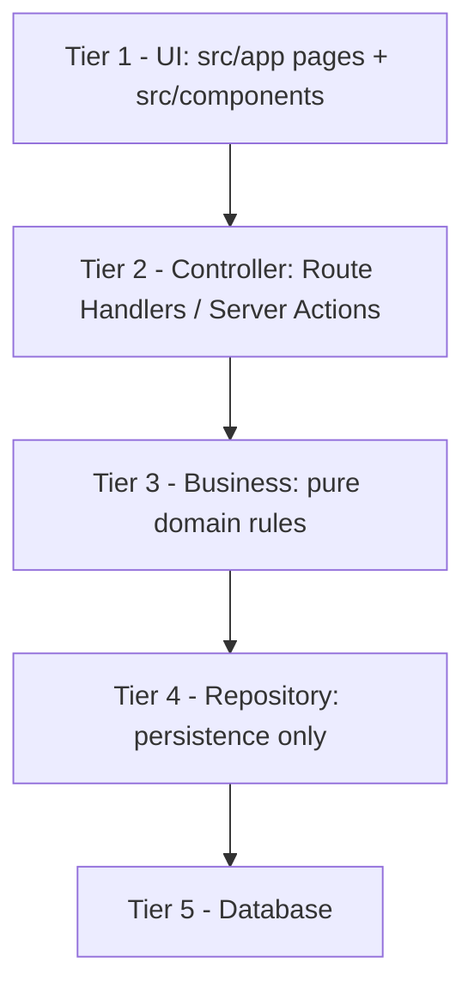
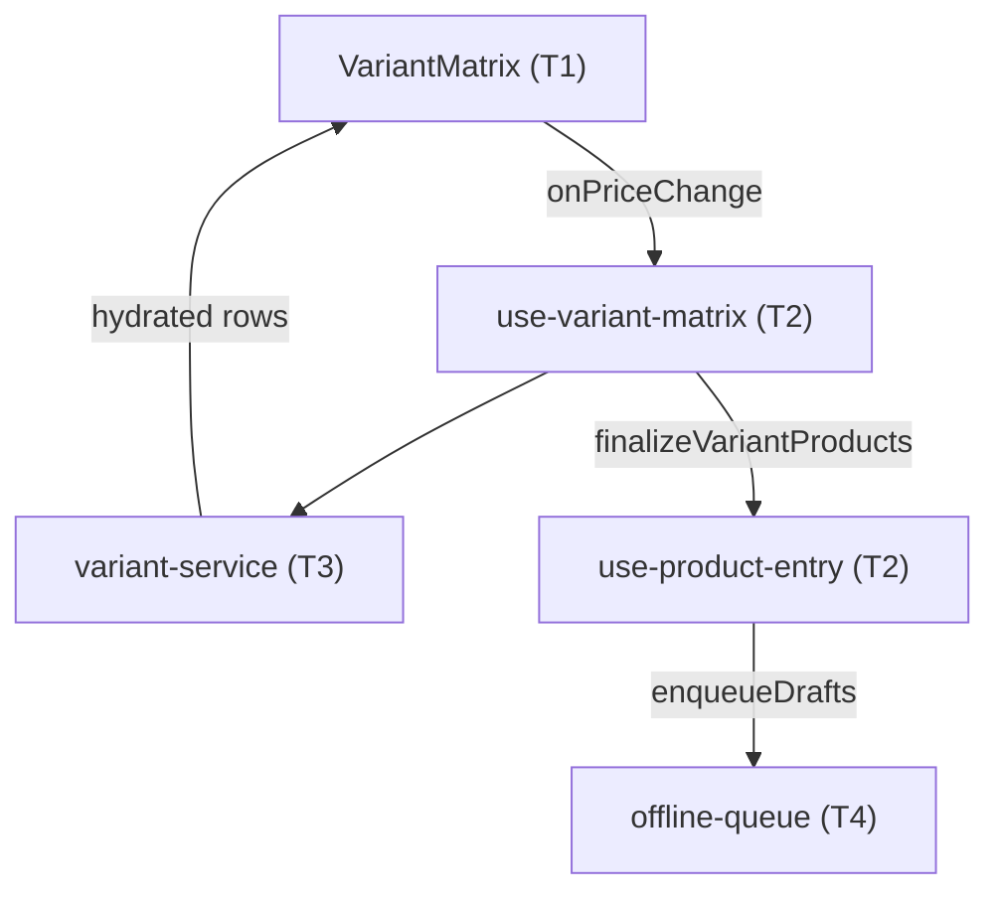
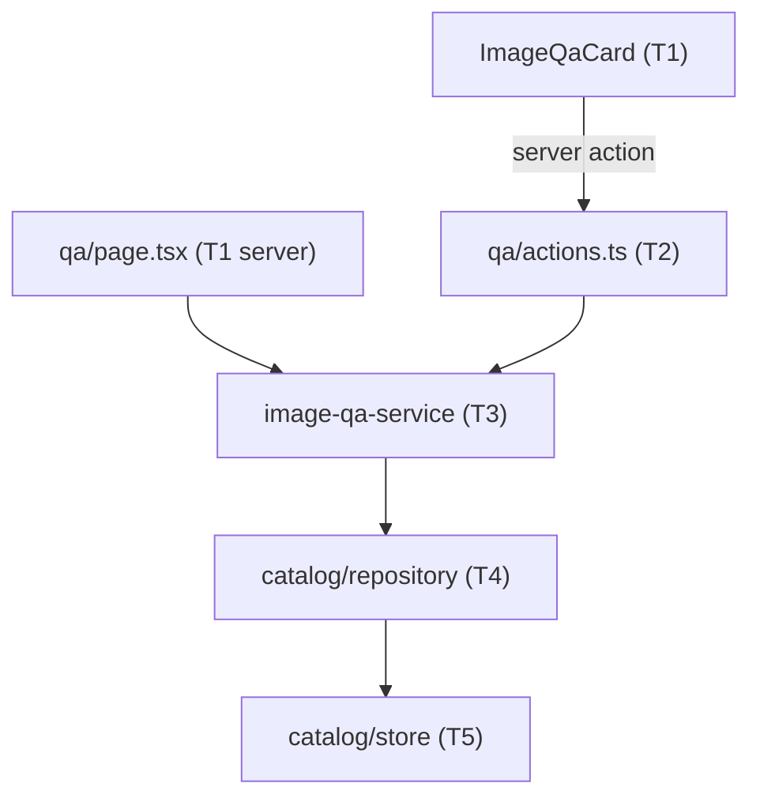
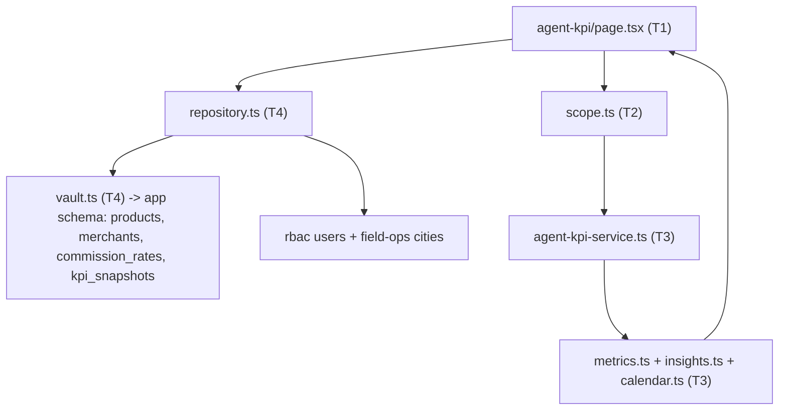

# Kanjo V2.0 — Architecture Blueprint

Branch: `feat/v2-enterprise-architecture`
Stack: Next.js 15.5 App Router · React 19 · TypeScript 5.7 · Zod 3.24 · Headless UI 2.2 · Tailwind 3.4

This document is the single source of truth for **where code belongs**. Read it
before touching any module. `AGENTS.md` holds the mandatory rules; this file
holds the map and the migration status.

---

## 1. The Five Tiers

Requests flow strictly downward. A tier may only import from tiers **below**
it. Never import upward, never skip a tier.



| Tier | Responsibility | Location | May import |
|---|---|---|---|
| 1 — UI | Render, view state, handlers. No domain rules, no I/O. | `src/app/**/page.tsx`, `src/components/**`, `src/components/ui/**` | T2 |
| 2 — Controller | Auth/authorization, input validation (Zod), status codes, shaping responses. No business rules. | `src/app/api/**/route.ts`, `src/lib/auth/api.ts` | T3 |
| 3 — Business | Domain rules, invariants, calculations. Zero DB or UI imports. | `src/lib/<domain>/*.ts` | T4 (types only ideally) |
| 4 — Repository | Only layer that reads/writes a database. Doc mapping and queries. | `src/lib/<domain>/repository.ts`, `src/lib/<domain>/store/**` | T5 |
| 5 — Database | Hybrid: Supabase (PostgreSQL) for Financial/ERP, Firebase for Operations. Connecting clients live in `src/lib/db/`. | external + `src/lib/**/data/seed.ts` | — |

### Tier rules in practice

- A controller route does: `authorizeAny([...])` → `schema.parse()` →
  `businessFn()` → `NextResponse.json()`. Nothing else.
- A component never calls `fetch("/api/...")` inline; it lives in a
  `use-*.ts` hook under the same domain folder.
- Domain functions are synchronous where possible and throw typed errors
  (`CatalogError`, `FieldOpsError`) that the controller maps with `apiError()`.

### Hybrid Database Strategy

Two databases, chosen by domain, never by convenience:

| Domain | Database | Tier 5 clients |
|---|---|---|
| Financial / ERP — users, RBAC, ledgers, wallets, commissions | Supabase (PostgreSQL) | `src/lib/db/supabase/{config,client,server}.ts` |
| Operations — live order tracking, complex catalog, offline-first field data | Firebase (Firestore) | `src/lib/db/firebase/{config,client,admin}.ts` |

- A repository talks to exactly one database. Cross-domain reads are composed
  one tier up (Tier 3), never with a SQL join against Firestore.
- `src/lib/db/supabase/server.ts` and `src/lib/db/firebase/admin.ts` import
  `server-only`; importing either from a client component is a build error.
- `firebase-admin` cannot run on the Edge Runtime. A controller that uses it
  MUST declare `export const runtime = "nodejs"`. All other routes stay `edge`.
- Configuration is read lazily inside the getters, so `next build` and
  `/login` succeed even when no database secrets are configured.

**Decision: Supabase is the committed SQL engine for Financial/ERP.** Its
PostgreSQL foundation gives real transactions, constraints and referential
integrity for ledgers, wallets and commissions, and its real-time channel keeps
wallet/commission balances live without polling. Firebase is not a candidate
for this domain.

---

## 2. Master Rules (summary of `AGENTS.md`)

1. **Small files** — hard limit 250–300 lines per `.ts`/`.tsx`. Generated data
   is the only exception and must live in `src/lib/**/data/`.
2. **Single responsibility** — layout, state, business logic and API access are
   separate modules.
3. **CSS modularity** — `src/app/globals.css` is an `@import` manifest plus
   global resets only. Domain CSS lives in `src/styles/<domain>.css`, tokens
   first.
4. **Refactor before extend** — touching an over-limit file requires a pure
   extraction commit first, verified by `typecheck` + `build`.
5. **Design system** — never use native `<button>`, `<input>`, `<select>` or
   raw Tailwind dropdowns. Use the primitives in `src/components/ui/`.
6. **Verification** — every refactor commit must pass `npm run typecheck` and
   `npm run build` (dev server must be stopped for the build).
7. **Production UI only** — never render architectural explanations,
   implementation notes, stack names, env var names, or placeholder/"dummy"
   paragraphs in React components. The DOM is for the end user: labels, values,
   states, and actions. Rationale, trade-offs and backend mechanics belong in
   `ARCHITECTURE.md`, code comments, or commit messages. If a reviewer would say
   "why is this text in the product?", delete it.

Full text: `AGENTS.md`.

---

## 3. Presentation Conventions

### Numerals

All numbers render as **Western digits (0-9)**, even inside Arabic text. Arabic
locales default to Eastern Arabic-Indic digits (`ar-EG` → `١٬٢٣٤٬٥٦٧`), so every
`Intl` formatter uses the `-u-nu-latn` extension:

```ts
new Intl.NumberFormat("ar-EG-u-nu-latn", { maximumFractionDigits: 0 });
new Intl.DateTimeFormat("ar-EG-u-nu-latn", { dateStyle: "medium" });
```

This keeps Arabic labels and month names while digits, separators and decimals
stay Latin. Never use a bare `ar-EG` locale for a formatter, and never
`toLocaleString("ar-EG")`. Canonical formatters live in
`src/lib/{bi,catalog,field-ops,kpi}/format.ts`; page-local formatters must follow
the same rule.

---

## 4. Environment & Configuration

All variables are read lazily by `src/lib/db/env.ts` and the domain config
modules, so a missing value fails at first use — never at import or build time.
Set them in Cloudflare Pages under **Settings → Variables and Secrets**; mark
every secret as encrypted.

### Required today (application boot)

| Key | Scope | Secret | Used by |
|---|---|---|---|
| `SESSION_SECRET` | Runtime | Yes | HMAC-SHA256 session cookie signing. Must be ≥ 16 chars; production throws otherwise. `src/lib/auth/session.ts` |

`NODE_ENV` is supplied by Next.js / Cloudflare — never configure it manually.

### Required once the Financial/ERP repositories are wired (Supabase)

| Key | Scope | Secret | Used by |
|---|---|---|---|
| `SUPABASE_URL` | Runtime | No | Project REST endpoint, e.g. `https://<ref>.supabase.co` |
| `SUPABASE_ANON_KEY` | Build + Runtime | No (public) | `getSupabaseBrowserClient()`; `signInWithPassword()` during login |
| `SUPABASE_SERVICE_ROLE_KEY` | Runtime | Yes | `getSupabaseServerClient()` — RLS-bypassing Tier 4 reads/writes, auth admin |

Login needs **all three**. The anon key verifies the password; the service-role
key reads the profile back from `app.users`. Missing any of them goes to
`/login?error=login-disabled` rather than silently falling back to the seed
roster.

The service-role key must never be prefixed with `NEXT_PUBLIC_`. It is used by
`app/api/admin/users/provision` to mint auth users, so leaking it would let
anyone create an operator account.

**Public signup must be disabled on the Supabase project.** Turn off email and
phone signups (Dashboard → Authentication → Sign In / Providers, or
`auth.enable_signup = false` in `supabase/config.toml`). Signup is not a product
feature here: accounts are provisioned top-down only (§8.6). If the flag is
left on, `POST /auth/v1/signup` remains reachable and would mint credential-only
accounts with no `app.users` profile, no grants, and no city scope.

### Required once the Operations repositories are wired (Firebase)

| Key | Scope | Secret | Used by |
|---|---|---|---|
| `NEXT_PUBLIC_FIREBASE_API_KEY` | Build + Runtime | No (public) | `getFirebaseWebConfig()` |
| `NEXT_PUBLIC_FIREBASE_AUTH_DOMAIN` | Build + Runtime | No (public) | `getFirebaseWebConfig()` |
| `NEXT_PUBLIC_FIREBASE_PROJECT_ID` | Build + Runtime | No (public) | `getFirebaseWebConfig()` |
| `NEXT_PUBLIC_FIREBASE_STORAGE_BUCKET` | Build + Runtime | No (public) | `getFirebaseWebConfig()` |
| `NEXT_PUBLIC_FIREBASE_MESSAGING_SENDER_ID` | Build + Runtime | No (public) | `getFirebaseWebConfig()` |
| `NEXT_PUBLIC_FIREBASE_APP_ID` | Build + Runtime | No (public) | `getFirebaseWebConfig()` |
| `NEXT_PUBLIC_FIREBASE_MEASUREMENT_ID` | Build + Runtime | No (public) | Optional analytics |
| `NEXT_PUBLIC_FIREBASE_APP_CHECK_SITE_KEY` | Build + Runtime | No (public) | Optional App Check |
| `FIREBASE_PROJECT_ID` | Runtime | No | `getFirebaseProjectId()`, admin app |
| `FIREBASE_CLIENT_EMAIL` | Runtime | Yes | Admin credential (when not using the JSON blob) |
| `FIREBASE_PRIVATE_KEY` | Runtime | Yes | Admin credential; literal `\n` sequences are restored |
| `FIREBASE_SERVICE_ACCOUNT` | Runtime | Yes | Alternative: full service-account JSON as one value |

`NEXT_PUBLIC_*` values are inlined at build time, so changing one requires a
redeploy, not just a restart. The Admin SDK variables are only needed by routes
declared `runtime = "nodejs"`.

### Do not add to the Pages environment

`FIREBASE_API_KEY`, `FIREBASE_AUTH_DOMAIN`, `FIREBASE_STORAGE_BUCKET`,
`FIREBASE_MESSAGING_SENDER_ID`, `FIREBASE_APP_ID`, `FIREBASE_MEASUREMENT_ID`,
`FIREBASE_APP_CHECK_SITE_KEY`, `KANJO_DRIVE_SCRIPT_URL`,
`KANJO_DRIVE_SCRIPT_TOKEN` belong to the legacy static site in `public/` and
its build scripts. The `SYNC_DRY_RUN` / `DRY_RUN` / `BACKUP_PATH` /
`CLAIMS_WRITE_DELAY_MS` family belongs to the GitHub Actions maintenance
scripts. Neither group is read by the Next.js app.

---

## 5. UI Primitive Library — `src/components/ui/`

All Headless UI backed. Brand styling lives inside each primitive via `data-*`
states; call sites never hand-roll purple/gold classes.

| File | Lines | Exports | Use for |
|---|---|---|---|
| `button.tsx` | 57 | `Button` | Every action / submit |
| `dropdown-menu.tsx` | 99 | `DropdownMenu` | Row and context actions |
| `tabs.tsx` | 97 | `Tabs` | Section / filter switchers |
| `form-inputs.tsx` | 234 | `Field`, `TextField`, `TextAreaField`, `CheckboxField`, `ToggleField`, `InputControl` | Form controls |
| `select-menus.tsx` | 237 | `SelectMenu`, `ComboField` | Selects and searchable pickers |
| `chip-toggle.tsx` | 33 | `ChipToggle` | Multi-select chips |
| `page-header.tsx` | 24 | `PageHeader` | Page titles |
| `stat-card.tsx` | 19 | `StatCard` | KPI tiles |
| `skeletons.tsx` | 183 | skeleton set | Loading states |
| `cx.ts` | 4 | `cx` | Class merge helper |

Aesthetic contract: rounded-full pills for tabs and menu triggers, rounded-lg
inside menu panels, high-contrast purple focus/open/hover states
(`--kanjo-interactive-hover` + white text, never white-on-white), soft shadows,
interactive-purple / gold accents. Selected tabs use the interactive purple with
white text (AA) so contrast never depends on the pastel wash alone. Dark mode is
driven by `data-theme="dark"` on `<html>` (see `tailwind.config.ts` `darkMode`
selector).

### Primitive rule: every `Label` needs a provider

Headless UI's `Label`, `Description` and `Switch.Label` read from a React
context. Rendering one without a parent that supplies it throws at render time
and takes down the whole route:

> `You used a <Label /> component, but it is not inside a relevant parent.`

This string comes from `@headlessui/react`, not from Recharts, even when the
crashing route happens to contain charts. Rules:

- Wrap labelling in `Field` (which renders Headless UI `Field`), or inside
  `Listbox` / `Combobox` / `Switch.Group`. Never render a bare `Label`.
- `Field` must stay a `HeadlessField`; downgrading it to a `<div>` re-breaks
  every `SelectMenu` that passes a `label`, including `/agent-kpi`.
- A primitive that takes a `label` prop owns the provider, so call sites cannot
  get this wrong.

---

## 6. Current Module Placement

### Database Clients (Tier 5)
- `src/lib/db/env.ts` — `optionalEnv`, `requireEnv`, `requireAnyEnv`,
  `MissingEnvError`. Every client resolves configuration through this module.
- `src/lib/db/supabase/config.ts` — lazy `SUPABASE_*` readers + `hasSupabaseConfig`.
- `src/lib/db/supabase/client.ts` — anon-key browser client (RLS enforced).
- `src/lib/db/supabase/server.ts` — service-role client for Tier 4 Financial/ERP
  repositories. `server-only`.
- `src/lib/db/supabase/errors.ts` — PostgREST error triage shared by every
  repository: `isMissingSchemaObject` (`42703`, `42P01`, `PGRST202`, `PGRST204`,
  `PGRST205`) and `isUniqueViolation` (`23505`). `rbac/rows.ts` and
  `commissions/repository.ts` re-export it so no domain keeps a private copy.
- `src/lib/db/firebase/config.ts` — lazy `NEXT_PUBLIC_FIREBASE_*` readers.
- `src/lib/db/firebase/client.ts` — memoised web app + Firestore with persistent
  cache and an in-memory fallback when IndexedDB is unavailable.
- `src/lib/db/firebase/admin.ts` — service-account Admin SDK for Operations
  writes. `server-only`; Node runtime only.
- `supabase/migrations/20261029000000_rbac_foundation.sql` — the validated
  `app` schema (RBAC tables, triggers, RLS). See Section 7.

Status: RBAC (`rbac/repository.ts`, `rbac/team-repository.ts`) and commission
rates (`commissions/repository.ts`) are live consumers. Every other domain still
runs on the in-memory stores below until it is migrated one at a time.

### Auth & RBAC (T1→T5)
- `src/lib/auth/api.ts` — `authorize`, `authorizeAny`, `authorizeMinClearance`, `apiError`, `readJson` (Controller helpers).
- `src/lib/auth/login.ts` — `resolveLoginRequest` / `safeNextPath`: verifies phone + password via `signInWithPassword`, then mints the app session. Never calls `redirect()`.
- `src/app/login/login-form.tsx` — phone + password form (client).
- `src/app/login/page.tsx` — login container.
- `src/app/api/auth/login/route.ts` — `POST` login Route Handler; sets the cookie and returns `NextResponse.redirect`.
- `src/app/api/auth/logout/route.ts` — `POST` logout Route Handler; clears the cookie and redirects.
- `src/lib/auth/server-session.ts` — `getServerSession()` and cookie I/O.
- `src/lib/auth/guard.ts` — `requireSession`, `requirePermission`, `requireMinClearance` (server components), `requireAnyPermission`.
- `src/lib/auth/session.ts` — HMAC token encode/verify.
- `src/lib/rbac/` — `permissions.ts` (15 modules / 49 keys), `users.ts` (async facade), `repository.ts` (Tier 4 Supabase reads/writes), `rows.ts` (row shapes, projections, schema-drift fallback), `seed-users.ts` (fallback only), `modules.ts`, `hierarchy.ts` (clearance + scope rules), `management.ts` (`assertCanCreate` / `assertCanPatch`).
- `src/lib/rbac/services/provisioning-service.ts` — `createUserAccount()`; top-down signup via `auth.admin.createUser`. See §8.6.
- `src/lib/rbac/services/provisioning-team.ts` — `resolveTeam()`: verifies the requested team exists, its city is reachable by the actor, and that city is inside the courier's scope.
- `src/lib/rbac/services/provisioning-writes.ts` — `createAuthUser`, `attachProfile`, `attachGrants`, `attachCityScope` (the three profile writes).
- `src/lib/rbac/services/team-service.ts` — `createTeam()`; mints a city-owned team, guarded by `assertCanManageCity()`.
- `src/lib/schemas/provisioning.ts` — `provisionAccountSchema` (E.164 phone, password 8–72, clearance, grants, cities; optional email; `teamId` required only for level 1).
- `src/lib/rbac/teams.ts` — `listTeams()`: DB-backed read of `app.field_teams`, returning `[]` when the table is absent (§8.5.1).
- `src/lib/rbac/team-repository.ts` — Tier 4 reads/writes for `app.field_teams`.
- `src/app/api/admin/teams/route.ts` — `POST` team controller (edge runtime); creates a team in a city the caller manages.
- `src/app/api/admin/users/provision/route.ts` — `POST` provisioning controller (edge runtime, `manage_system_users`).
- `src/lib/city-scope*.ts` — `effectiveCityIds`, `canAccessCity`, `scopedCities`.

**Public signup is disabled.** No signup route or `signUp()` call exists; accounts are only created top-down by an authorised operator (§8.6).

#### Why login is a Route Handler, not a Server Action

`next-on-pages` cannot resolve `redirect()` inside an Edge Server Action; it
throws `Invariant: Missing initURL` and the POST returns HTTP 500. Login and
logout therefore POST to plain route handlers. Rules locked in:

- **Never call `redirect()` from a Server Action on this branch.** Return a path
  and let the caller navigate, or use a Route Handler.
- The handlers build an absolute redirect URL from `x-forwarded-host` /
  `x-forwarded-proto`, because Cloudflare terminates TLS upstream and the
  internal request URL carries the wrong origin.
- `safeNextPath` rejects `//host` and absolute URLs, so `?next=` cannot be used
  as an open redirect.
- `src/app/login/actions.ts` is a deprecated, redirect-free shim; the forms now
  target `/api/auth/login` and `/api/auth/logout` directly.


### Catalog (Tier 1–5)
- UI: `src/components/catalog/` (`catalog-client` 121, `product-card` 133,
  `product-form` 256, `cascading-taxonomy` 164, `use-product-entry` 270,
  `draft-list-item`, `draft-queue-banner`, `variant-matrix`, filter tabs).
- Controller: `src/app/api/catalog/products/`, `+ [id]/image-qa`, `+ sync`, and
  the QA server actions in `src/app/(workspace)/catalog/qa/actions.ts`.
- Business: `src/lib/catalog/services/variant-service.ts` (variant algebra) and
  `services/image-qa-service.ts` (image review state machine + city scope), plus
  `filters.ts`, `sku.ts`, `category.ts`, `draft-types.ts`. `variants.ts` and
  `image-qa.ts` are deprecated shims over the services.
- Data access: `src/lib/catalog/offline-queue.ts` (draft queue) over
  `draft-storage.ts` (IndexedDB/localStorage); `draft-queue.ts` is a shim.
- Repository: `src/lib/catalog/store.ts` (279) — in-memory store + CRUD/sync;
  `src/lib/catalog/repository.ts` — merchant-city resolution + QA commits.
- Data: `src/lib/catalog/data/seed.ts` (85).
- Schema: `src/lib/schemas/catalog.ts`.
- State enum: `draft → pending_review → completed → published`.
- Image QA gated by `manage_catalog | review_catalog_images`; drafts edit gated
  by `manage_catalog | create_products`.
- QA workspace lives at `/catalog/qa` (nav module `review_catalog_images`).

### Field Ops (Tier 1–5)
- UI: `src/components/field-ops/` (client shells, modals, visit engine, geo
  panel). Note: `field-ops-client.tsx` (831) and `cities-client.tsx` (760)
  exceed the limit — see backlog.
- Controller: `src/app/api/field-ops/**` (board, cities + managers,
  merchants + documents/edit-requests/reports/state/transfers, search, tasks,
  transfers, visits/sync, edit-requests), plus `geo-intelligence` and `session`.
- Business: `src/lib/field-ops/` — `offline-queue.ts`, `types.ts`,
  `firestore.ts` (doc mappers).
- Repository: `src/lib/field-ops/store.ts` is a barrel over
  `store/core.ts` (store accessor, ids, clock) and `store/operations.ts`.
  The concrete repositories are `store/{cities,merchants,tasks,visits,transfers,
  edits,documents,state,crm,dates}.ts`; `store/seed.ts` (565) is seed data.
- Legacy in-memory global store guarded by `__kanjoV2FieldOpsStore`.

### Taxonomy (Tier 1–5)
- UI: `src/app/(workspace)/catalog/taxonomy/taxonomy-center.tsx` (764 — over
  limit).
- Controller: `src/app/api/taxonomy/**` (entries, requests, approve, reject).
- Repository: `src/lib/taxonomy/store.ts` (707 — over limit);
  `src/lib/taxonomy/data.generated.ts` (2219 — allowed, generated).

### BI / Overview (Tier 1 + 3)
- UI: `src/app/(workspace)/overview/`, `src/components/` charts.
- Business: `src/lib/bi/` — `dataset.ts` (190), `select.ts`, `tables.ts`,
  `drill.ts`, `export.ts`, `format.ts`, `mock.ts`, `types.ts`.
- Overview header is sticky: `ExecutiveDashboard` accepts an optional `header`
  node and renders it inside `.bi-sticky-head`, pinned at
  `top: var(--topbar-height)`. `--topbar-height` is a token (72px), overridden
  to 64px at ≤1023px where the shell topbar shrinks. The page header and the
  filter bar travel in that slot so filters stay reachable while scrolling.
- BI catalog health is binary: `published` versus `missing`. Review-only states
  (`pending_review`, `completed`) fold into `missing` because they are not yet
  live in the consumer catalog. There is no "draft" product state: a product is
  created directly into `pending_review`.
- `dataset.ts` is server-only and ships a fully-denormalized payload. Treasury
  facts (`treasury`, `accounts`, `ledger`, `payslips`) are computed there from
  the accounts and payroll stores and travel inside `BiDataset`, so browser
  components never import a server store. Importing a store client-side would
  bundle a second, divergent ledger into the JS and let the dashboard disagree
  with `/accounts`.
- `tables.ts` builders are pure: they accept dataset slices (`accountsTable`,
  `ledgerTable`, `payrollTable`) rather than reading stores themselves. Drills
  receive the same slices through `BiScopedData`. Treasury rows are
  company-wide, so `scopeDataset` passes them through unfiltered.
- Charts guard their own empty state. `FunnelStageChart` skips Recharts when
  every slice is `0`, and `ComplianceDonut` when every `complete` is `0`,
  rendering `.bi-chart-empty` / `.bi-donut-empty` instead. Never mount a
  `Funnel`/`Pie` with `LabelList`/`Cell` children over zero rows.

### Agent KPI (Tier 1–5)
- UI: `src/app/(workspace)/agent-kpi/page.tsx` (server container) plus
  `components/{kpi-filter-bar,kpi-agent-card,kpi-metric-grid,kpi-rank-card,kpi-insights-panel}.tsx`.
- Controller: page-level authorization (`view_global_kpi` or `view_rep_kpi`),
  URL filter parsing (`parseKpiFilters`, incl. the vault `month`), and scope
  resolution (`resolveKpiScope`). Reps (L1/L2) are pinned to themselves; admins
  (clearance ≥ 3) may filter city/team/rep/month.
- Business: `src/lib/kpi/services/agent-kpi-service.ts` (snapshots, city-scoped
  rank, top-performer), `metrics.ts` (vault facts, live salary pricing,
  scoring), `insights.ts` (gap heuristics), `scope.ts`, `calendar.ts` (month
  arithmetic). All pure.
- Repository: `src/lib/kpi/vault.ts` reads the SQL Vault (live month queries
  and `app.kpi_snapshots`); `src/lib/kpi/repository.ts` composes the RBAC
  roster + city catalogue with the vault into a `KpiDataset`. No mock seeds.
- Ranking is **strictly city-scoped**; scores from different cities are never
  compared. Metrics come from the city stage:
  `preparation → contracting → data_entry → live_operations`.
- CSS: `src/styles/kpi.css` manifest over `src/styles/kpi/{layout,metrics,ranking,insights,responsive}.css`.
- Empty scope is a **rendered state, not an error**. When no rep matches the
  viewer's scope (a fresh workspace has no field reps yet), the service throws
  `KpiError("EMPTY_SCOPE")`; the page catches it and renders `KpiEmptyState`.
  Letting it escape produced an RSC application error (digest 788090452).

### Accounts / Treasury (Tier 1–5)
- UI: `src/app/(workspace)/accounts/page.tsx` (server container) plus
  `components/accounts/{accounts-view,account-card,account-form,ledger-entry-form}.tsx`.
- Business: `src/lib/accounts/ledger.ts` — `summarizeAccount`, `summarizeAll`,
  `totalByCurrency`. Balance is always `Σdeposits − Σexpenses`, never stored.
- Data: `src/lib/accounts/{store,seed,types,format}.ts`. `store.ts` is the
  process-local Tier 4 seam; `20261030000100_accounts_ledger.sql` is its SQL
  mirror. Per-currency totals: EGP and SAR never sum together.
- App/Edge: `GET|POST /api/accounts` and `POST /api/accounts/ledger`.
  `manage_accounts` implies read, so a manager can resolve the account it
  writes to.
- Access tiers (`src/lib/accounts/access.ts`, pure): treasury has two
  audiences, both derived from capabilities, never job titles.
  - **Full book** — holding `view_accounts` or `manage_accounts`. Sees every
    account in both countries, every movement, the derived balance and expense
    totals. This is the Founder / System Admin / Head of Accounts audience.
  - **Deposit-only** — holding `record_deposits`. Opens the module to record
    deposits into Egyptian accounts only. `visibleAccounts` drops non-Egyptian
    accounts, `visibleEntries` drops every expense row, and the page renders no
    balance and no expense total. `assertCanRecord` rejects an expense or a
    Saudi account before the store is touched, so editing the request body
    cannot escalate the tier.
- The ledger is append-only at both tiers: TypeScript exposes no update/delete,
  and `app.ledger_reject_mutation()` blocks UPDATE/DELETE even for the owner.
  A correction is a new opposing entry.

### Profile & Founder Capital (Tier 1–5)
- UI: `src/app/(workspace)/profile/page.tsx` (own profile) and
  `src/app/(workspace)/admin/finance/reviews/page.tsx` (treasury review), plus
  `components/profile/` (`profile-identity-card`, `profile-password-card`,
  `payout-method-card`, `capital-deposit-card`, `capital-review-board`,
  `use-profile`, `use-capital-review`).
- Business: `src/lib/profile/{types,capital,profile,capital-service,errors}.ts`.
  `types.ts` and `capital.ts` are the Zod contracts (one discriminated union per
  payout method); `profile.ts` and `capital-service.ts` are the Tier 3 rules;
  `errors.ts` maps PostgREST/trigger failures onto domain errors.
- Data: `src/lib/profile/{repository,capital-repository,storage,upload}.ts`
  (Tier 4/5). Split by table group to stay under the file-size limit; the
  SQL half is `20261102000001_user_profiles_and_capital.sql` plus
  `20261102000002_capital_treasury_gate.sql`.
- App/Edge: `GET|PATCH /api/profile`, `POST /api/profile/password`,
  `PUT /api/profile/payout-method`, `POST /api/profile/upload`,
  `GET|POST /api/capital-deposits`,
  `POST /api/capital-deposits/[id]/decision`,
  `POST /api/payout-methods/[id]/decision`.
- Every route derives the operator from the session. There is no `id`
  parameter on the self-service surfaces, so no request can point at another
  operator by editing the body.
- `/profile` is `sessionOnly` in `rbac/module-catalog.ts`: nobody is *granted*
  access to their own record, so `permissionsForPath()` returns an empty list and
  the middleware accepts any valid session. The review surface is gated by the
  full-book treasury capabilities, not by rank.

### Payroll (Tier 1–5)
- UI: `src/app/(workspace)/payroll/page.tsx` plus
  `components/payroll/{payroll-view,payroll-table}.tsx`.
- Business: `src/lib/payroll/engine.ts` — `tieredCommission` (cumulative bands,
  sorted ascending), `computePayroll`, `finalize`. All pure.
- Data: `src/lib/payroll/{store,seed,types}.ts`. Contribution is derived from
  live visit reports, not stored on the payroll profile, so payroll can never
  disagree with the commission dashboard.
- SQL: `20261030000200_payroll.sql` — `payroll_profiles`,
  `payroll_commission_tiers` (cumulative bands), `payroll_kpi_links`,
  `payroll_runs`, `payroll_lines`, and the `payroll_run_totals` view.

### Finance — Commission Rates (Tier 1–5)
- UI: `src/app/(workspace)/admin/finance/rates/page.tsx` (Server Component,
  60 lines) plus `src/components/admin/finance/`
  (`commission-rates-view`, `use-commission-rates`, `use-commission-rates-form`).
- Business: `src/lib/commissions/rates.ts` — `activeRateForCity()` (override
  first, else the NULL-city fallback), `loadActiveCommissionRate()`,
  `saveCommissionRate()` insert-or-update with `23505` recovery,
  `CommissionRatesError`.
- Data: `src/lib/commissions/repository.ts` (Tier 4 for `app.commission_rates`),
  `src/lib/commissions/types.ts`, `src/lib/schemas/commission-rates.ts`.
- Controller: `src/app/api/admin/commission-rates/route.ts` — `GET` / `PUT`.
- **Gated by clearance rank AND the module capability.** `modules.ts` declares
  `minClearance: 4` with `permission: "manage_commission_rates"`, the Server
  Component calls `requireMinClearance(4)` then
  `requirePermission("manage_commission_rates")`, the Route Handler calls
  `authorizeMinClearance(4)`, and SQL requires `app.has_min_clearance(4)` on
  update/insert/delete. The nav filter reads the same fields, so the sidebar
  never advertises a route the guard will refuse.
- Lookup mirrors `app.commission_rates_for()`: a city row when present,
  otherwise the NULL-city global row. Two rows are never merged, so an override
  is a complete configuration. `city_id` is Firestore text with no FK (§8.4);
  `UNKNOWN_CITY` (422) is returned before SQL is touched.
- A fee is a non-negative EGP amount (`numeric(12,2)`). The schema turns an
  empty submission into `NaN` rather than `0`, so a cleared field cannot save an
  unintended zero fee.
- **The contract fee is tiered by achievement**, not flat:
  tier 1 `[0, 80)`, tier 2 `[80, 90)`, tier 3 `[90, 100)`, tier 4 `[100, ∞)`.
  The boundaries live in exactly one place per side —
  `app.contract_fee_tier(numeric)` in SQL and `contractFeeTier()` in
  `src/lib/commissions/types.ts` — and both must agree. `100%` is tier 4: the
  ladder is half-open and gap-free, so no achievement value is ever unpaid.
  A null achievement (no target, or a target of zero) is tier 1, never an
  unearned bonus. `app.contract_fee_for(city, achievement)` resolves the same
  override/fallback pair as `commission_rates_for()`, then selects the band; the
  TypeScript twin is `contractFeeForAchievement()` in `rates.ts`.
- SQL: `20261031000000_enterprise_kpi_vault.sql` (`app.commission_rates`,
  `has_min_clearance`), `20261031000002_city_specific_rates.sql` (`city_id`,
  two partial unique indexes, drops the singleton trigger,
  `commission_rates_for()`), `20261031000003_city_teams_and_contracting.sql`
  (`contracts_closed`, `avg_achievement_ratio`), and
  `20261102000000_tiered_contract_commissions.sql` (the four
  `contract_fee_tier_*` columns, `achievement_percent()`, `contract_fee_tier()`,
  `contract_fee_for()`, `applied_contract_fee`).
- `20261102000000_tiered_contract_commissions.sql` is additive and safe: it
  adds the four tiers, backfills **all four from the old flat fee** so the
  migration changes no amount by itself, and only then drops
  `contracting_base_fee`. Every statement is guarded (`if not exists`, `if
  exists`, `coalesce`), so a re-run is a no-op.
- `20261031000001_snapshot_rate_history.sql` freezes `applied_merchant_rate` /
  `applied_item_rate` onto `app.kpi_snapshots` and extends the immutability
  guard. Pre-existing rows stay NULL — the true rate is unrecoverable, and
  inventing one would put false evidence in the ledger.
  `20261102000000` adds `applied_contract_fee` beside them on the same terms.

### Marketing Measurement (Tier 1–5)
- UI: `src/app/(workspace)/marketing/page.tsx` plus
  `components/marketing/{marketing-view,marketing-entry-form,campaign-form,campaign-card,settings-panel}.tsx`.
  Five tabs: campaigns, new campaign, daily results, records, platform settings.
- Data: `src/lib/marketing/{store,types,platforms}.ts`. Manual entries are
  append-only.
- Campaign is the unit of work: a campaign owns the plan (name, platform,
  channel, budget, lead/conversion targets, date window) and every daily entry
  points at one campaign. `platform` (`meta`, `tiktok`, `google`, `snapchat`,
  `offline`) is who bills us; `channel` (`instagram`, `tiktok`, `google`,
  `referral`, `field`) is where the audience saw the ad. The guard trigger
  copies platform/channel from the campaign onto each entry so the two can
  never drift, and the dashboard filters on platform while grouping by channel.
- Status ladder: `active ⇄ paused → closed`. `closed` is terminal — enforced in
  TS (`setCampaignStatus`) and by `app.marketing_campaign_terminal`, so a
  closed campaign's figures can never move again.
- Progress is always derived from entries via `campaignProgress()` /
  `app.marketing_campaign_totals` (spend, leads, conversions, budget left);
  nothing is stored twice.
- Credentials: `platforms.ts` holds a per-platform field spec (regex per field)
  and `verifyPlatformCredentials()` runs the format check server-side.
  `updatePlatformSettings()` refuses `enabled: true` unless verification
  passes; the PUT route answers 422 otherwise. `offline` is manual-only and
  never needs credentials.
- API keys are write-only: the store keeps the raw value server-side and
  exposes `apiKeyConfigured` only. SQL stores `api_key_ciphertext` and the
  client reads the `marketing_platform_settings_public` view.
- SQL: `20261030000300_marketing.sql` (entries) and
  `20261030000600_marketing_campaigns.sql` (campaigns, entry `campaign_id` /
  `leads` / `note`, guard trigger, terminal trigger, totals view). The funnel is
  constrained: `clicks ≤ impressions`, `conversions ≤ clicks` and
  `leads ≤ clicks`.

### Data Entry (Tier 1 + 2)
- UI: `src/app/(workspace)/data-entry/page.tsx` plus
  `components/data-entry/data-entry-view.tsx`.
- Flow is merchants first, then that merchant's products. Selecting a row is
  view state only; the page is a server container that passes scoped rows down.
- Shares the `view_catalog` capability and the same city scope as the catalog.

### CSS
- Manifest: `src/app/globals.css` (4807 lines — still over limit, extraction backlog).
- Domains: `src/styles/{tokens,bi,catalog,kpi,field-ops-actions,rbac,accounts,payroll,commissions,marketing,data-entry}.css` plus
  `catalog/*` (cards, controls, form, matrix, qa, responsive) and `bi/*`
  (charts, layout, negotiation, overlay, responsive, stats).

---

## 7. Migration Gaps (target end-state)

The tiers exist conceptually; these are the concrete gaps to close.

1. **In-memory stores are still the live Tier 5.** Every domain
   (`rbac/users.ts`, `catalog/store.ts`, `field-ops/store/`, `taxonomy/store.ts`,
   `kpi/repository.ts`) reads a process-local global. On Cloudflare these are
   per-isolate, so data is neither durable nor consistent across requests. The
   connection clients now exist in `src/lib/db/`; the remaining work is to move
   each domain behind a `repository.ts` that uses them, one domain per commit:
   - Financial/ERP → Supabase: RBAC users, ledgers, wallets, commissions.
     **Progress:** the accounts ledger, payroll, marketing and commission-rate
     tables now exist in SQL (§8.7), and the commission schedule is fully wired
     (`errors.ts`, `modules.ts`, `guard.ts`, `api.ts`).
     The remaining stores (`lib/accounts`, `lib/payroll`,
     `lib/marketing`) still read a process-local global. The schemas are the
     contract; wiring the repositories is the remaining step.
   - Operations → Firebase: catalog, field ops, live orders.
2. **RBAC reads and writes are now Supabase-backed.** `rbac/repository.ts`
   implements the Tier 4 seam and `rbac/users.ts` is an async facade over it.
   The seed roster is consulted only when Supabase is not configured; once it
   is, a missing row means "no such operator" rather than a demo fallback.
   Password login uses `signInWithPassword`. Remaining: the write paths in
   `field-ops/store/cities.ts` still mutate the in-memory city store alongside
   RBAC grants, so a grant can succeed while the city assignment is process-local.
3. **Create paths.** The admin UI now posts to
   `POST /api/admin/users/provision` (the real path) and re-reads the roster
   afterwards. The legacy `POST /api/admin/users` still calls the seed-only
   `createUser()`, which throws when Supabase is configured; it is kept only
   for the not-yet-migrated callers and should be removed once they are gone.
4. **Repository seams are partially created.** `catalog/repository.ts`,
   `kpi/repository.ts` and `rbac/repository.ts` exist. `field-ops` and
   `taxonomy` still mix business rules with persistence.
5. **Service extraction started.** `src/lib/catalog/services/` now holds the
   variant and image-QA services, and `src/lib/catalog/repository.ts` is the
   reserved Tier 4 seam. Other domains still mix business and persistence in
   `src/lib/<domain>/store.ts`; extract pure rules into
   `src/lib/<domain>/services/` and leave only queries in `store/`.
6. **`catalog/store.ts` mixes validation (T3) with mutation (T4).** Split into
   `catalog/rules.ts` and `catalog/repository.ts`.
7. **`taxonomy/store.ts` (707)** holds business decisions (approve/reject) and
   persistence together. Split and drop below 300.
8. **Page components are still clients.** Move view state into `use-*.ts` so
   `page.tsx` stays a server container.
9. **Files over the 300-line limit (backlog):**
   - `src/components/field-ops/field-ops-client.tsx` — 831
   - `src/app/(workspace)/catalog/taxonomy/taxonomy-center.tsx` — 764
   - `src/components/field-ops/cities-client.tsx` — 760
   - `src/lib/taxonomy/store.ts` — 707
   - `src/lib/field-ops/store/seed.ts` — 565
   - `src/components/field-ops/request-modals.tsx` — 506
   - `src/lib/field-ops/types.ts` — 449
   - `src/lib/geo/egypt.ts` — 426
   - `src/lib/field-ops/offline-queue.ts` — 344
   - `src/components/field-ops/ops-team-panel.tsx` — 327
   - `src/app/globals.css` — 4884 (extract to `src/styles/<domain>.css`)
10. **Business rules need negative-space tests.** Domain functions are pure;
   add unit coverage before wiring new persistence.
11. **Schema has no automated test.** The RBAC migration was validated by hand
   against PostgreSQL 15. Port those checks into a repeatable SQL or pgTAP
   suite so the governor invariant cannot silently regress.

Generated data exception: `src/lib/taxonomy/data.generated.ts` is the only file
allowed above the limit.

---

## 8. Data Persistence — Hybrid Schema Contract

Tier 5 is deliberately split between two systems. Nothing may be stored in both.

| Concern | System | Why |
|---|---|---|
| Identity, RBAC, city scope | Supabase (PostgreSQL) | Transactional, foreign keys, auditable writes |
| Contracts, wallets, ledgers, commissions | Supabase (PostgreSQL) | ACID money movement; a lost write is a financial incident |
| Catalog, merchants, tasks, visits, city geometry | Firebase (Firestore) | Offline-first writes, realtime sync, GeoJSON payloads |
| Taxonomy | Firebase (Firestore) | Grows without migrations; edited by field staff |

Rule: any entity that participates in a money movement or an authorization
decision is SQL. Anything that is primarily edited offline in the field is
NoSQL. A document never spans both stores.

### 8.1 RBAC Schema

Source of truth for the TypeScript side stays `src/lib/rbac/`. The database
mirrors it, it does not redefine it: `app.permissions` seeds from
`permissions.ts` (15 modules / 49 keys), and `app.users.clearance_level` follows
`hierarchy.ts` (1–4).

The migration lives at `supabase/migrations/20261029000000_rbac_foundation.sql`.
It creates the `app` schema, four tables, three triggers, two RLS helpers, and
policies. It is validated end-to-end against PostgreSQL 15.

| Table | Purpose |
|---|---|
| `app.permissions` | Capability catalogue, one row per key |
| `app.users` | Operator profile + authorization state (`team_id` → `app.field_teams`) |
| `app.user_permissions` | Explicit capability grants (no roles table) |
| `app.user_city_scope` | Per-operator city restriction |
| `app.field_teams` | City-owned field teams (`20261031000003_city_teams_and_contracting.sql`) |

Load order is `permissions` → `users` → `user_permissions` → `user_city_scope`.
`app.field_teams` must exist before `app.users.team_id` can reference it.

The capability catalogue is exactly the 15 modules below (49 keys); the Arabic
labels live in `src/lib/rbac/permissions.ts` and the SQL seed mirrors the keys:

| Module | Keys |
|---|---|
| نظرة عامة (Overview) | `view_overview_contracts`, `view_overview_negotiation`, `view_overview_finance`, `view_overview_catalog`, `view_overview_compliance`, `view_overview_marketing` |
| المدن (Cities) | `manage_cities`, `view_active_cities`, `view_geo_operations`, `add_city` |
| التجار (Merchants) | `view_merchants`, `view_merchant_profile`, `add_merchant` |
| الكتالوج (Catalog) | `view_catalog`, `edit_catalog`, `add_catalog` |
| مراجعة الصور (Images) | `edit_product_images`, `review_image_quality` |
| التصنيفات (Categories) | `review_add_requests`, `manage_merchant_types`, `manage_categories`, `manage_variables` |
| مؤشرات المناديب (Rep KPIs) | `view_global_kpi`, `view_rep_kpi` |
| العمليات الميدانية (Field Ops) | `assign_tasks`, `view_all_teams_visits`, `start_end_visit`, `write_report`, `request_ownership_transfer`, `approve_ownership_transfer`, `approve_report_edits` |
| العقود (Contracts) | `draft_contract`, `edit_contract`, `sign_contract`, `cancel_contract` |
| الحسابات البنكية (Banking) | `view_bank_balances`, `add_bank_account`, `view_bank_transactions`, `record_bank_transaction` |
| الرواتب (Payroll) | `view_payroll_sheets`, `view_employee_payslip` |
| التسويق (Marketing) | `view_campaigns`, `create_campaign`, `record_campaign_results`, `view_marketing_logs`, `manage_platform_settings` |
| إدخال البيانات (Data Entry) | `view_pricing_and_status` |
| أسعار العمولات (Commission Rates) | `manage_commission_rates` |
| مستخدمين النظام (System Users) | `manage_system_users` |

**Teams are city-owned, not global.** `app.field_teams(id, city_id, name)` is
unique per `(city_id, lower(name))`, and `app.users.team_id` points at one row.
The legacy free-text `app.users.team` label is kept, deprecated, only because
the provisioning service and legacy readers still write it; `team_id` is
authoritative. Reads embed the owning row (`field_teams!team_id(name)`, i.e. a
`left join`) and expose it as `AppUser.teamName`; the deprecated `team` column is
kept unchanged because merchant ownership in field-ops/KPI still compares
against that vocabulary. Deleting a team sets `team_id` to NULL, but a merchant contract
(`app.merchants.contracted_by_team_id`) is `on delete restrict`, so attribution
survives. `app.can_manage_city(city_id)` gates team writes: an executive (level
≥ 3) owns every city, a level-2 manager only their scoped cities.

### 8.2 Identity: phone + password, and nothing else

Login is **phone number + password**. Email is optional profile data and is
therefore neither required nor unique.

- Credentials are owned by Supabase `auth.users`. Kanjo never stores a password
  hash of its own; there is no custom password column anywhere in `app`.
- `app.users.id` is a foreign key to `auth.users.id`, and `app.users.phone`
  mirrors `auth.users.phone` through the `auth_user_upsert_profile` trigger.
- Phone is constrained to E.164 (`^\+[1-9][0-9]{7,14}$`) and is unique.
- The same trigger raises `AUTH_PHONE_REQUIRED` if an auth user appears without
  a phone, so a phone-less account can never be created.
- `email` accepts NULL and carries no unique index. Duplicate emails are legal.

### 8.3 Authorization invariants enforced in SQL

These mirror the pure functions in `src/lib/rbac/`, so the rules hold even if a
write bypasses the application.

| Invariant | Mechanism |
|---|---|
| `global_scope` never drifts from clearance | `generated always as (clearance_level >= 3) stored` |
| Clearance stays within 1–4 | `users_clearance_range` check |
| At least one active `manage_system_users` holder | Deferred constraint triggers on `app.user_permissions` and `app.users` |
| Ordinary profile edits stay legal | Guards fire only on governor-removal events, so the first operator can be bootstrapped |
| Stale sessions can be invalidated | `auth_revision` counter |
| Level 4 holds the whole catalogue | `20261030000800_l4_full_permission_backfill.sql`, converged by `20261101000000_seed_l4_new_permissions.sql` |

Level 4 is the supreme tier: an L4 account holds exactly the 49 catalogue keys,
so it always reports 49/49. Suspension is expressed by `app.users.active` and
`is_active_user()`, never by withholding grants — a reactivated L4 returns whole
instead of half-blind. `20261101000000` upserts the 15-module catalogue, deletes
the L4 grants that point at keys the catalogue no longer contains, re-grants the
49, bumps `auth_revision`, and raises an exception if any L4 row does not end up
with exactly 49. It is keyed to `clearance_level = 4` only — under the Hierarchy
Security Rule L3 is strictly below L4, so L3 keeps whatever it was granted.
`20261030000700` used `>= 3` for the five treasury keys; that was a one-time
delta, not the tier rule.

The governor guard is the SQL twin of `assertActiveGovernor()` in
`src/lib/rbac/users.ts`. It rejects removing or deactivating the last active
governor, but permits any unrelated update — an earlier draft fired on every
update and made bootstrapping the first operator impossible.

### 8.4 Cross-database reference

`app.user_city_scope.city_id` has **no foreign key**. City documents live in
Firestore, so referential integrity is a Tier 3 responsibility. The column is
`text` and is validated only as non-empty at the database layer.

### 8.5 Row Level Security

All four tables have RLS enabled *and* forced, so even the table owner is
subject to policy. `has_permission()` and `is_active_user()` are
`security definer` to avoid a policy on `app.users` recursing into itself.

| Surface | Policy |
|---|---|
| `app.permissions` | Read by any active operator; writes are service-role only |
| `app.users` | Read own row, or all rows with `manage_system_users`; writes are governor-only |
| `app.user_permissions` | Read own grants (needed to build a session), or all with `manage_system_users` |
| `app.user_city_scope` | Same shape as grants |
| `app.field_teams` | Read by any active operator (needed to pick a team); insert/update/delete only via `can_manage_city(city_id)` |

Self-service profile edits must go through a dedicated RPC rather than a direct
`UPDATE`, so a user can never raise their own `clearance_level` or flip `active`.

### 8.5.1 Schema drift must not 500 a page

Application code and migrations deploy separately, so a release can reach
production before `20261031000003_city_teams_and_contracting.sql` has run. That
is exactly what happened when the city/team picker shipped: the Add User page
selected `app.users.team_id` and queried `app.field_teams`, both of which were
absent, so PostgREST returned `42703` / `42P01` during the Server Component
render and the route answered HTTP 500 with *An error occurred in the Server
Components render*.

The rule: **a missing new schema object degrades a feature, it never tears down
the page.**

- `src/lib/db/supabase/errors.ts` owns `isMissingSchemaObject()`, which
  recognises `42703` (no column), `42P01` (no table), and `PGRST202` /
  `PGRST204` / `PGRST205` (stale schema cache). `PGRST200` (no relationship in
  the schema cache) counts as a missing embed. `src/lib/rbac/rows.ts` owns the
  row shapes and re-exports the helper.
- `selectUserRows()` degrades in three steps: profile + `field_teams!team_id(name)`,
  then profile + `team_id` (no embed), then `USER_COLUMNS_LEGACY` (no
  `team_id`). The roster always renders; `teamId` falls back to `null` and
  `teamName` falls back to `null` while `team` keeps the legacy label.
- `listTeams()` returns `[]` when `app.field_teams` is absent, so the dialog
  simply offers to create the first team.
- The RBAC grants/scope reads (`loadRbacSnapshot`, `getUserProfile`) treat a
  missing `user_permissions` / `user_city_scope` table as empty during a
  migration window, so session resolution keeps working while the schema
  catches up; every non-schema error is still re-thrown.
- `listCommissionRateRows()` (finance rates page) never throws inside a Server
  Component: any read failure — missing table, stale schema cache, transient
  outage — degrades to `null`, and the page renders its "finance database
  unavailable" state instead of a 500. The KPI vault reads
  (`src/lib/kpi/vault.ts`) follow the same contract: `null` on schema drift,
  honest zeros in the UI.
- Write paths answer `503 TEAM_STORE_UNAVAILABLE` rather than a raw PostgREST
  code. `attachProfile` retries without `team_id` for a non-team profile, but
  **refuses** when a team was requested: a courier must never be provisioned
  with no team.

Genuine errors (`42501` RLS denials, `23505` uniqueness) are re-thrown untouched,
so this fallback never hides an authorization bug.

**Finance rates read.** `src/lib/commissions/repository.ts` degrades through
three projections — the tiered columns, then the old flat `contracting_base_fee`
(copied into all four bands so no amount changes), then no contracting fee at
all. Since the finance-500 fix, `listCommissionRateRows()` itself never throws
out of a Server Component: missing table (`42P01` / `PGRST205`), missing
`city_id` (`42703`) or any transient failure degrades the read to `null`, and
the page renders its "finance database unavailable" state. Writes keep the
strict error behaviour.

### 8.6 No Self-Service Signup — Top-Down Provisioning

**Public registration is strictly disabled.** There is no signup route, no
`signUp()` call anywhere in the app, and no "create account" link on `/login`.
An account can only come into existence when an authorised operator mints it.
Kanjo is B2B operations software, not a consumer product: every identity is
issued by someone who is accountable for it.

Supabase's phone provider must stay closed to public signup. Set
`auth.enable_signup = false` (Dashboard → Authentication → Providers, or
`supabase/config.toml`) so the only remaining path is the Admin API used by
Tier 3. Without that setting the REST `/auth/v1/signup` endpoint would still
mint accounts behind the app's back.

#### The Hierarchy Security Rule

A user holding `manage_system_users` may only **see, edit and create** users who
are inside their own city scope **and** have a **strictly lower clearance
level** than themselves. Peers and superiors are invisible on the users
surface, for executives included: an L4 may assign at most L3 and can never see
or edit another L4 account. Without `manage_system_users` the page does not
render at all.

| Actor | Level | Creates | Scope it may grant |
|---|---|---|---|
| System Admin | 4 | Levels 1–3 (strictly lower) | Any city, any permission it holds |
| Founder | 3 | Levels 1–2 (strictly lower) | Any city, any permission it holds |
| City Operations Manager | 2 | Field Reps (level 1) | Only their own cities |
| Field Rep | 1 | Nobody | — |

`governsLevel()` is strict (`actor.level > target.level`) for every rank, and
`maxAssignableLevel()` always returns `actor.level − 1`, so peer-minting is
impossible by construction — no shared-custody exception, no `global_scope`
escape hatch. Self-management stays blocked separately (`assertCanManage`
rejects `target.id === actor.id`).

The add-user dialog (`CreateUserModal`) collects phone, password, full name,
optional email, job title, team (when level 1), city scope and the individual
capability grants, grouped by the 15 `PERMISSION_GROUPS`. The client never
posts to the legacy `POST /api/admin/users`; provisioning goes through the
route above and the roster is re-read afterwards, because the auth account,
grants and scope are all assigned server-side.

Rules enforced for every creation:

1. **Assignable rank.** `canAssignLevel(actor, level)` — strictly below the
   actor's own rank, always. This one rule lives only in Tier 3: provisioning
   writes through the service-role client, which bypasses RLS and carries no
   actor identity, so a database trigger could not tell who is granting. The
   other three rules below are enforced in both tiers.
2. **Permission subset.** The grantor can only hand out permissions they
   themselves hold (`permissionsAreWithinActor`). No capability can be
   invented during provisioning.
3. **City subset.** A non-global actor can only assign cities from their own
   `accessibleCities`. Global actors (level ≥ 3) may assign any city.
4. **Global ranks are executive-only.** Levels 3–4 require a global actor.

These live in `assertCanCreate()` in `src/lib/rbac/management.ts`, backed by the
helpers in `hierarchy.ts`.

#### The write path

All four writes happen server-side; the service-role key never leaves the
server.

```
POST /api/admin/users/provision        (protected Route Handler, edge)
  → getServerSession()                 verify cookie + re-read live grants
  → require manage_system_users        else 401 / 403
  → provisionAccountSchema.parse()     E.164 phone, password 8–72 chars
  → assertCanCreate(session, input)    rank / permission / city subset
  → resolveTeam(session, input)        team exists, city reachable, city in scope
  → supabase.auth.admin.createUser()   SERVICE ROLE, phone + password
      ├─ trigger: app.handle_auth_user_upsert mirrors phone/email
      ├─ update app.users                profile: name, title, team_id, clearance
      ├─ insert app.user_permissions     explicit capability grants
      └─ insert app.user_city_scope      city assignments
  → on any failure: auth.admin.deleteUser()  cascade rollback
```

Implementation:

- `src/lib/schemas/provisioning.ts` — `provisionAccountSchema`. Phone is E.164;
  password is capped at 72 characters because bcrypt silently truncates beyond
  that, and a silent truncation would make the stored credential differ from
  what the operator typed. Email is optional profile data (never an identity,
  never unique); `teamId` is required only when `clearanceLevel === 1`, because
  a courier is always dispatched through a team.
- `src/lib/rbac/team-repository.ts` / `teams.ts` — teams are **city-owned** rows
  in `app.field_teams`, not a global label set. The page passes the whole
  catalogue to the dialog, which filters it by the selected city; there is no
  seed fallback, because a team only exists once it is created inside a city.
  `listTeams()` returns `[]` when the table is absent (§8.5.1).
- `src/lib/rbac/services/provisioning-team.ts` — `resolveTeam()`. Reads the
  city from the team row (never from the client), rejects a team the actor
  cannot reach, and rejects a team whose city is not in the courier's scope. The
  same city is what `app.can_manage_city()` authorises on the database side.
- `src/lib/rbac/services/provisioning-writes.ts` — profile / grants / scope
  writes. `attachProfile` writes both `team_id` (authoritative) and the
  deprecated free-text `team` label so legacy readers stay correct during the
  migration.
- `src/lib/rbac/services/provisioning-service.ts` — `createUserAccount()`. Pure
  orchestration over the service-role client; no UI, no HTTP concerns.
- `src/app/api/admin/teams/route.ts` — team controller. `GET` lists one city's
  teams for the picker; `POST` mints a team, and both require the caller to
  reach the city (`assertCanManageCity`, mirroring the SQL policy).
- `src/app/api/admin/users/provision/route.ts` — thin controller. It only
  authenticates, delegates, and maps errors to status codes.

The handler declares `runtime = "edge"`. `auth.admin.*` works there because
`@supabase/supabase-js` is fetch-based; a route left on the Node runtime breaks
`next-on-pages`, which requires every route to opt into Edge. Do not call
`redirect()` here — see §5 on `next-on-pages`.

#### Deployment prerequisites

Three project-level settings are required; none of them live in application code.

1. **Expose the `app` schema to PostgREST.** The service writes through
   `.schema("app")`, which only resolves if `app` is listed under
   Dashboard → API → Exposed schemas (or `schemas = ["public", "app"]` in
   `config.toml`). Without it every write fails with *The schema must be one of
   the following*. Exposing `app` is safe: RLS is forced and the policies only
   admit `authenticated` or `service_role`.
2. **Grant `service_role` table privileges.** The foundation migration grants
   `authenticated` only, so `20261029000100_rbac_service_role_grants.sql` adds
   `usage` plus DML on the four `app` tables for `service_role`. `service_role`
   also carries `BYPASSRLS` on Supabase, which is what makes the provisioning
   writes succeed despite the forced policies.
3. **Seed `app.permissions`.** `user_permissions.permission_key` is a foreign
   key, so provisioning fails until the 49 keys from `permissions.ts` exist as
   rows. `20261029000200_seed_permissions.sql` seeds them idempotently from the
   live catalogue; run it before creating the first account.
4. **Keep the auth-mirror trigger outside RLS.** `app.users` uses
   `force row level security`, which applies even to the table owner. A
   `SECURITY DEFINER` function only escapes RLS when its owner holds
   `BYPASSRLS`; Supabase's migration-running role does not. When the foundation
   migration was applied by such a role, `app.handle_auth_user_upsert()` was
   rejected with *new row violates row-level security policy*, and GoTrue
   reported it only as `[unexpected_failure] Database error creating new user`
   (HTTP 500) — with no hint that RLS was involved. `20261029000300_fix_auth_mirror_rls.sql`
   grants the trigger's owning role explicit `insert`/`select`/`update`
   policies. The same migration adds `app.bootstrap_diagnostics()`, which
   reports the trigger owner, whether it bypasses RLS, whether RLS is forced,
   and the policy list, so this failure is self-explaining.
5. **Normalize the blank email GoTrue sends.** `auth.users.email` is nullable,
   but GoTrue stores an empty string rather than `NULL` for a phone-only
   account. The mirror trigger copied that value verbatim and
   `users_email_shape` rejected it, producing the same opaque
   `Database error creating new user` / HTTP 500 — again indistinguishable from
   the RLS failure until the diagnostics showed `owner_bypassrls: true`.
   `20261029000400_fix_auth_mirror_email.sql` replaces the trigger with one that
   maps blank email to `NULL` (`nullif(btrim(email), '')`), backfills any rows
   written before the fix, and adds `app.bootstrap_probe()` which reports the
   constraint definition and how many blank emails remain. Real addresses are
   still validated, and a malformed one is still rejected.
6. **Canonicalize the phone before the E.164 check.** Supabase's
   `auth.users.phone` holds the number *without* the leading `+`
   (`201040491882`), while the Admin API accepts it *with* the `+`
   (`+201040491882`). The trigger copied the stored value verbatim, so
   `users_phone_e164` (`^\+[1-9][0-9]{7,14}$`) rejected it — the same opaque
   500 a third time. `20261029000500_fix_auth_mirror_phone.sql` adds
   `app.normalize_phone()`, which reduces any input to one `+` plus digits, and
   the trigger now writes that canonical form. `app.bootstrap_probe()` reports
   the shape of GoTrue's newest stored phone plus any non-canonical rows, since
   `auth` is not an exposed schema and cannot be queried from PostgREST.

#### Bootstrapping the first Founder (chicken-and-egg)

Provisioning is governor-only, so the very first account cannot be created
through the UI. It is created out of band with
`scripts/bootstrap-founder.mjs`, which uses the Admin API:

```
node --env-file=.env.local scripts/bootstrap-founder.mjs
```

It is idempotent and re-convergent: it creates the auth user (or resets the
password on an existing phone), sets `clearance_level = 4`, and grants every row
in `app.permissions`. Granting all permissions does not violate the governor
invariant — the guard only blocks *removing* the last governor.

The bootstrap was originally also exposed as a temporary Edge route,
`GET /api/admin/bootstrap`. It has been deleted, together with
`bootstrap-service.ts` and `bootstrap-diagnostics.ts`: the founder signs in
normally now, and a self-provisioning endpoint that mints an all-powerful
account is scaffolding, not a product surface. The
`app.bootstrap_diagnostics()` SQL helper survives in
`20261029000300_fix_auth_mirror_rls.sql` for the next mirror failure, but no
route calls it.

**Never write directly into `auth.users`.** Supabase owns credential storage;
an INSERT there bypasses GoTrue's password hashing and its `auth.identities`
rows, yielding an account that cannot sign in. The Admin API is the supported
path and fires `app.handle_auth_user_upsert`. A SQL-only bootstrap is impossible
for the same reason: `encrypted_password` must be a GoTrue-compatible bcrypt
hash plus a matching identity row, which is implementation detail, not API.

#### Password login

Login is now real. `resolveLoginRequest()` in `src/lib/auth/login.ts`:

1. calls `supabase.auth.signInWithPassword({ phone, password })` with the anon
   key, so Supabase verifies the credential and Kanjo never sees a hash;
2. reads the profile back from `app.users` through the service-role repository;
3. refuses if the profile is missing or `active = false` — a valid Supabase
   credential with no authorisation row is not a valid operator;
4. mints the HMAC session cookie from the repository's grants and revision.

Login therefore requires **all three** Supabase variables (`URL`, `ANON_KEY`,
`SERVICE_ROLE_KEY`). With only the anon key, the profile read would fall back to
the seed roster and every correct password would fail, which is
indistinguishable from a wrong password. A missing configuration redirects to
`/login?error=login-disabled` instead.

The login page is a phone + password form (`login-form.tsx`). The demo roster
picker is gone, and `login.css` replaces the dead `.account-*` rules.

#### Failure handling

Provisioning is multi-step and must not leave a half-created account. The auth
user is created first, because `app.users.id` is a foreign key to
`auth.users.id`. If any profile, grant, or scope step fails, the auth user is
deleted; `on delete cascade` removes the dependent rows. Partial accounts are
therefore impossible, and the operator sees a retryable error rather than a
zombie login.

`granted_by` records the authorising operator for audit. It is set only when
the session id is a real UUID, because seed/demo sessions use `u-*` ids.

#### Team selection in the add-user dialog

A courier is the only rank that needs a team, and a team is city-owned
(`app.field_teams`), so the picker is dependent on the city scope:

1. The operator ticks the courier's cities first.
2. `TeamPicker` (`src/components/admin/team-picker.tsx`) lists only the teams of
   the selected city; with several cities the operator picks the owning city
   explicitly, with one it is implied.
3. "Create new team" posts `{ cityId, name }` to `POST /api/admin/teams`,
   which enforces `assertCanManageCity()` (executive anywhere, city manager only
   in their scoped cities) and relies on the per-city case-insensitive unique
   index to reject duplicates.
4. Removing a team's city from the courier scope also clears the selected team,
   so the dialog can never submit a team the rep does not cover.
5. Provisioning receives `teamId`; `resolveTeam()` re-reads the team, derives
   its city from the row, and persists `app.users.team_id` (plus the deprecated
   `team` label) in `attachProfile`.

#### What replaces the old create flow

The existing `POST /api/admin/users` writes to the in-memory `createUser()`
store and collects an email. It stays until the RBAC repository lands, but it is
**not** the production path: it cannot mint credentials. `createUser()` should
gain a phone field and then delegate to `createUserAccount()` once the
repository reads `app.users`.

### 8.7 Money: treasury, payroll and marketing

Every table below is SQL because each one participates in a money movement or a
financial report. All ledger amounts are **minor units** (`bigint`), never
floats, so no rounding can create or destroy value. The exception is the
commission fee schedule: a rate is a price list in EGP, stored as
`numeric(12,2)` (see below the table).

| Migration | Tables | Invariant enforced in SQL |
|---|---|---|
| `20261030000100_accounts_ledger.sql` | `app.bank_accounts`, `app.ledger_entries`, view `app.account_balances` | Balance is derived (Σdeposits − Σexpenses), never a column. UPDATE/DELETE on the ledger raise `LEDGER_IMMUTABLE`. Entry currency must equal the account currency. |
| `20261030000200_payroll.sql` | `app.payroll_profiles`, `app.payroll_commission_tiers`, `app.payroll_kpi_links`, `app.payroll_runs`, `app.payroll_lines`, view `app.payroll_run_totals` | Components are non-negative; `deduction` supplies the sign. Net is a signed sum in the view, never a stored total. |
| `20261030000300_marketing.sql` | `app.marketing_platform_settings`, `app.marketing_entries`, view `app.marketing_platform_settings_public` | Entries are append-only. `clicks ≤ impressions`, `conversions ≤ clicks`. API keys are ciphertext and never exposed to client roles. |
| `20261030000400_seed_treasury.sql` | seed only | Asserts SAR deposits 4,865,000 / expenses 3,973,631 / balance 891,369 minor units before committing. |
| `20261030000500_treasury_access.sql` | adds `record_deposits`, rewrites account/ledger read+insert policies, grants the four prior migrations' tables to `authenticated` and `service_role` | Tiered treasury: deposit-only callers read Egyptian accounts and `deposit` rows only, and may insert deposits against an Egyptian account. The Saudi account and all expenses stay invisible. |
| `20261031000000_enterprise_kpi_vault.sql` | `app.commission_rates`, `app.kpi_snapshots`, `app.merchants`, `app.catalog_products`; `app.has_min_clearance(integer)` | Fee schedule is one global row; reads are any active operator, writes require clearance level 4. |
| `20261031000001_snapshot_rate_history.sql` | adds `applied_merchant_rate` / `applied_item_rate` to `app.kpi_snapshots` | A snapshot's rates are mandatory on insert and frozen thereafter, so a slip can always be reconciled against the schedule that produced it. Pre-existing rows stay NULL. |
| `20261031000002_city_specific_rates.sql` | `app.commission_rates.city_id`, partial unique indexes, `app.commission_rates_for(text)` | One row per city plus exactly one NULL-city fallback (two partial unique indexes, because `UNIQUE` allows many NULLs). The residue of the old singleton trigger is dropped; L4 gains insert/delete. |
| `20261031000003_city_teams_and_contracting.sql` | `contracts_closed` / `avg_achievement_ratio` on `app.kpi_snapshots`; adds the then-flat `contracting_base_fee` | Fees are non-negative; the new snapshot outcomes join the frozen set. |
| `20261102000000_tiered_contract_commissions.sql` | replaces `contracting_base_fee` with `contract_fee_tier_1..4`; `achievement_percent()`, `contract_fee_tier()`, `contract_fee_for()`; `applied_contract_fee` on `app.kpi_snapshots` | Backfills all four tiers from the old flat fee before dropping it, so the migration changes no amount. Bands are half-open and gap-free; `100%` is tier 4. The applied fee is frozen with the snapshot. |
| `20261102000001_user_profiles_and_capital.sql` | `app.user_payout_methods`, `app.capital_deposits`, `avatar_url` + `bank_info_status` on `app.users`, storage buckets | One payout method per operator; any detail edit resets the decision to `pending` (`payout_methods_reset_decision`). A capital approval appends exactly one ledger entry in the same transaction (`capital_deposit_decide`) and is immutable thereafter. Self-review is refused by `PAYOUT_SELF_REVIEW` / `CAPITAL_DEPOSIT_SELF_REVIEW`. |
| `20261102000002_capital_treasury_gate.sql` | `app.can_manage_treasury()`, rewritten payout/capital policies | The first migration gated decisions on the legacy `manage_accounts` key, which the 49-key catalogue no longer contains — the policies would have been unreachable. Decisions now follow the full-book treasury capabilities, the same rule `resolveTreasuryAccess()` applies. |

Commission rates are **numeric EGP, not minor units**: the schedule is a price
list read by humans, and `numeric(12,2)` keeps the two decimal places Postgres
already rounds correctly. The cache-and-freeze rule still holds — every money
movement derived from a rate is stored in minor units on the ledger, and the KPI
snapshot freezes the rate that produced it.

Ledger and marketing immutability is enforced by a trigger rather than a policy
so it holds for every role, including the table owner and the service role. The
safe settings view is `security_invoker`, so it inherits the caller's RLS.

`manage_accounts` also grants read on accounts and the ledger. A manager that
could insert but not select would silently write nothing: the insert's
`select ... from app.bank_accounts` returned zero rows, so `INSERT 0 0` looked
like success. The policy now accepts `view_accounts OR manage_accounts` for
reads and requires `manage_accounts` for writes.

The four treasury migrations created policies but no table privileges, so
`authenticated` could not read the tables at all and RLS was never consulted.
`20261030000500_treasury_access.sql` adds the missing grants; without them the
policies are inert. Verified on local PG15 as `authenticated`: a
`record_deposits`-only caller sees one Egyptian account and `deposit` rows
only, its expense insert raises an RLS violation, and its Saudi deposit inserts
zero rows, while a `view_accounts` caller sees both accounts and both kinds.

---

## 9. Refactored Modules

### Catalog — Smart Variant Matrix

The variant entry flow is the reference implementation of the five tiers.
Each tier owns exactly one concern:

| Tier | File | Responsibility |
|---|---|---|
| 1 — UI | `src/components/catalog/variant-matrix.tsx` | Dumb grid. Receives `selectedAttributes` + hydrated `rows` as props, renders name/SKU read-only and uses `InputControl` for the price only. Dispatches `onPriceChange(key, value)` upward. |
| 1 — UI | `src/components/catalog/product-form.tsx` | Presentation form. Consumes the controller hook; no domain math. |
| 2 — Controller | `src/components/catalog/use-variant-matrix.ts` | Derives view state (matrix → hydrated rows → selected labels) and memoises it. |
| 2 — Controller | `src/components/catalog/use-product-entry.ts` | Owns form state, validation order and save orchestration; calls the service, then the queue. |
| 3 — Business | `src/lib/catalog/services/variant-service.ts` | Pure and zero-dependency: `generateVariantMatrix`, `hydrateVariantCombinations`, `finalizeVariantProducts`. No React, no IndexedDB. |
| 4 — Data access | `src/lib/catalog/offline-queue.ts` | `enqueueDraft` / `enqueueDrafts` / `flushDrafts` + reads. Stores fully hydrated payloads only. |

Data flow:



Rules locked in by this refactor:

- Names (`base + attributes`) and SKUs (`KJ-<vendor>-<seed><seq>`) are produced
  once, in Tier 3, so the matrix and the queued draft can never disagree.
- The UI never imports from `src/lib/catalog/*` except read-only types and the
  hydrated row shape.
- `src/lib/catalog/variants.ts` and `src/lib/catalog/draft-queue.ts` are now
  deprecated re-export shims; new code imports the service / queue directly.

### Catalog — Image Quality Assurance (QA) Pipeline

The QA workspace proves the 5-tier model end-to-end with server actions.

| Tier | File | Responsibility |
|---|---|---|
| 1 — UI | `src/app/(workspace)/catalog/qa/page.tsx` | Server container: `requirePermission("review_catalog_images")`, calls the service, renders stats + board. |
| 1 — UI | `src/components/catalog/image-qa-board.tsx` | Client shell; owns lightbox state and message timeout only. |
| 1 — UI | `src/components/catalog/image-qa-card.tsx` | Dumb card: image, price, SKU and the three exits (تحميل / رفع المحسنة / اعتماد مباشر) built from `Button` + `DropdownMenu`. |
| 2 — Controller | `src/app/(workspace)/catalog/qa/actions.ts` | `"use server"` actions enforce RBAC, validate the data URL, call the service, `revalidatePath`. |
| 2 — Controller | `src/components/catalog/use-image-qa-board.ts` | Client glue: busy state, optimistic removal, `prepareImage` before upload. No domain rules. |
| 2 — Controller | `src/app/api/catalog/products/[id]/image-qa/route.ts` | Legacy REST entry point; same service + repository, same guards. |
| 3 — Business | `src/lib/catalog/services/image-qa-service.ts` | `ImageQaError`, `getPendingReviewProducts`, `approveImage`, `uploadEnhancedImage`, plus pure `assertImageQaTransition` / `applyImageQa`. Repository is injected — zero Tier 4 imports. |
| 4 — Repository | `src/lib/catalog/repository.ts` | `listCatalogRecords` / `findCatalogRecord` (merchant→city) and `commitImageQa`. Only layer that touches `catalog/store.ts`. |
| 5 — Database | `src/lib/catalog/store.ts` + `data/seed.ts` | In-memory global store and seed fixtures. **Target:** Firebase Firestore via `src/lib/db/firebase/` (catalog is an Operations domain). |

Data flow:



Rules locked in by this pipeline:

- `pending_review → completed` only; any other starting state raises
  `IMAGE_QA_NOT_PENDING` (verified: a replay returns 422).
- City scope is enforced twice: in the service (`getPendingReviewProducts`,
  `approveImage`, `uploadEnhancedImage`) and in the legacy route. An
  out-of-scope reviewer receives `PRODUCT_NOT_FOUND` (verified).
- RBAC: page and actions both require `manage_catalog | review_catalog_images`;
  a user without it is redirected to `/forbidden` (verified).
- All buttons in the QA surfaces use the `Button` primitive; row extras use
  `DropdownMenu`.

---

## 10. Agent KPI Dashboard — SQL-Backed Vault

The dashboard renders per-rep monthly figures from the SQL Vault. The same rep
is scored across the four vault axes; the card keeps the city stage rail as
context, but the numbers are no longer computed from in-memory field-ops or
catalog mock data — every figure is either a live SQL count or a frozen
snapshot row.

| Tier | File | Responsibility |
|---|---|---|
| 1 — UI | `agent-kpi/page.tsx` | Server container: `requireAnyPermission([view_global_kpi, view_rep_kpi])`, loads the vault month, resolves scope, renders cards. |
| 1 — UI | `components/kpi-filter-bar.tsx` | Client shell; writes city/team/rep/window/month into the URL. No math. |
| 1 — UI | `components/kpi-agent-card.tsx` | Layout: identity, stage rail, vault metric grid, snapshot badge, insights + rank. |
| 1 — UI | `components/kpi-metric-grid.tsx`, `kpi-rank-card.tsx`, `kpi-insights-panel.tsx` | Dumb presentational blocks. |
| 2 — Controller | `src/lib/kpi/scope.ts` | `parseKpiFilters` (incl. `month`), `resolveKpiScope`, `buildKpiFilterOptions`, `isKpiAdmin`. |
| 3 — Business | `src/lib/kpi/services/agent-kpi-service.ts` | `buildKpiReport`, `getAgentSnapshot`, `selectAgents`; 0–100 score and city rank. |
| 3 — Business | `src/lib/kpi/metrics.ts` | `factsFor` (rep + shared team attribution), `computeLiveSalary`, `scoreVaultFacts`, `vaultMetrics`. |
| 3 — Business | `src/lib/kpi/insights.ts` | `buildInsights` compares the agent with the city top performer on the vault axes. |
| 3 — Business | `src/lib/kpi/calendar.ts` | Month keys, window bounds, labels, recent-month options. Pure. |
| 4 — Repository | `src/lib/kpi/vault.ts` | The only SQL reader: live month queries and `app.kpi_snapshots`. Degrades to `null`. |
| 4 — Repository | `src/lib/kpi/repository.ts` | `loadKpiDataset(month)`: RBAC roster + field-ops city catalogue + vault inputs. No mocks. |
| 5 — Database | `app` schema (Supabase) | `catalog_products`, `merchants`, `commission_rates`, `kpi_snapshots`. |

### Vault reading rules

- **Current month (live).** Every figure is counted on read:
  - *Data entry* — `app.catalog_products` rows created this month, counted by
    `created_by`.
  - *Activations* — `app.merchants` rows whose `first_entry_at` falls this
    month, counted by `first_entry_by`.
  - *Contracting* — `app.merchants` rows in `final_contract`/`signed_contract`
    with `contracted_by_team_id` set and `updated_at` this month; the count and
    the average agreed/target margin ratio are credited to the team, so paired
    reps share the credit (the split is a payout concern, not a schema one).
  - *Live salary* — priced from the active `app.commission_rates` row for the
    rep's `city_id` (override first, then the NULL-city global row):
    `activations × merchant_activation_fee + items × photo_item_fee +
    contracts × contracting_base_fee × marginRatio`.
- **Past months (vault).** Read strictly from `app.kpi_snapshots`
  (`new_merchants_activated`, `items_added`, `contracts_closed`,
  `avg_achievement_ratio`, `calculated_salary`, `status`). Snapshots are
  immutable after lock; only `status` moves `pending → paid`, and only an L4
  may move it.
- **Scope.** Reps (L1/L2) are pinned to their own row; admins (clearance ≥ 3)
  may filter city/team/agent/month. Ranking stays strictly city-scoped — a Giza
  rep is never compared to a Cairo rep.
- **No mocks.** The old `globalThis` seed dataset (`facts-seed.ts`, in-memory
  merchants/products/visits/usage) is purged from the KPI path. A deployment
  without the vault configured renders an honest zeroed state with an explicit
  "database not connected" note, never fabricated numbers.
- **Schema drift must not 500.** `vault.ts` returns `null` on missing schema
  objects and transient failures, mirroring `rows.ts` and the commission-rates
  read; the page maps `null` to the unavailable state.

Data flow:



---

## 11. The AI Workflow Loop (MANDATORY)

Every AI session on this branch follows this loop. No exceptions.

1. **Read first.** Before any code change, read `ARCHITECTURE.md` (this file)
   and `AGENTS.md`.
2. **Locate the tier.** Decide which tier(s) the task touches and confirm the
   target file is under the size limit. If it is over, the first commit is a
   pure extraction.
3. **Implement downward.** UI → Controller → Business → Repository. Respect the
   import direction.
4. **Verify.** Run `npm run typecheck` and `npm run build` (stop the dev server
   first).
5. **Update this file.** After every task that changes structure, module
   placement, primitives, or the migration gaps, edit `ARCHITECTURE.md` in the
   same change set. A task is not done until the document matches reality.
6. **Commit.** Conventional commit on `feat/v2-enterprise-architecture`; never
   amend a failed commit — fix forward.

If a rule and this document disagree, `AGENTS.md` wins; then update this
document.
